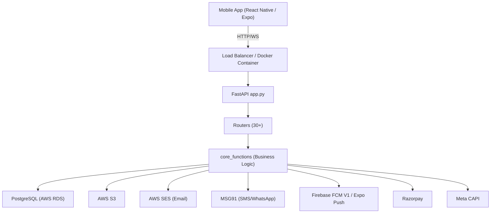
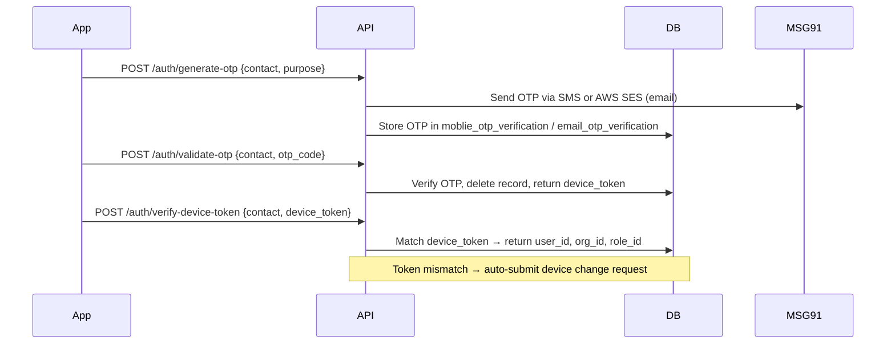
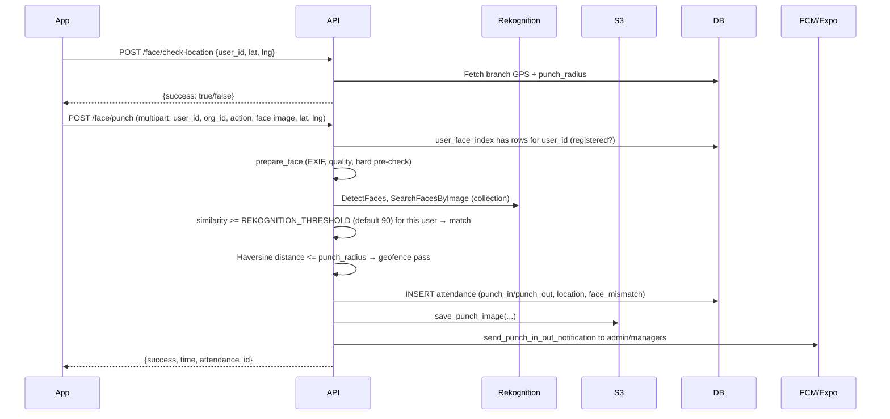
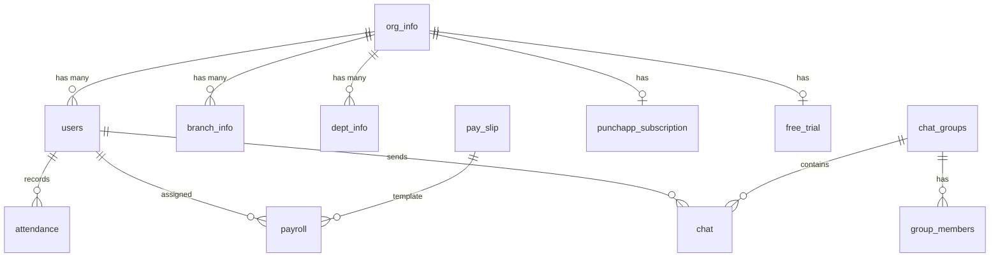
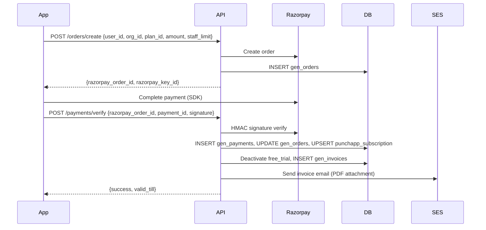
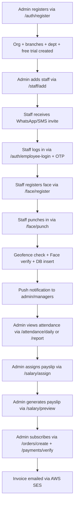

# Clockyn — Backend

FastAPI backend for Clockyn (product name set by `APP_NAME`) — a workforce management platform with face-based attendance, payroll, chat, CRM, and subscription billing.

---

## Tech Stack

| Layer | Technology |
|---|---|
| Framework | FastAPI + Uvicorn |
| Database | PostgreSQL (AWS RDS) via psycopg2 connection pool |
| Storage | AWS S3 (punch photos, profile photos, org logos, chat files); AWS Rekognition collection (face index) |
| Email | AWS SES |
| SMS / WhatsApp | MSG91 |
| Push Notifications | Expo Push API + Firebase FCM V1 |
| Face Recognition | AWS Rekognition (collection, `ml/face_service.py`) + local ONNX anti-spoof model (optional) |
| Payments | Razorpay |
| PDF / Invoice | ReportLab + WeasyPrint |
| Real-time | WebSocket (chat) + SSE (force-logout) |
| Meta Analytics | Meta Conversions API (CAPI) |
| Container | Docker (python:3.11-slim) |

---

## Folder Structure

```
clockyn-backend/
├── app.py                  # FastAPI app entry point, CORS middleware, router registration
├── socket_manager.py       # WebSocket ConnectionManager (chat, group chat)
├── migrate.py              # DB migration runner
├── Dockerfile
├── requirements.txt
├── .env                    # Environment variables
│
├── router/                 # API route definitions (thin layer — delegates to core_functions)
│   ├── auth.py             # /auth/*
│   ├── face_attendance.py  # /face/*, /attendance/*
│   ├── home.py             # /home/*
│   ├── add_staff.py        # /staff/*
│   ├── branch.py           # /branch/*
│   ├── company.py          # /company/*
│   ├── department.py       # /department/*
│   ├── shift.py            # /shift/*
│   ├── employee.py         # /employee/*
│   ├── salary.py           # /salary/*
│   ├── daily_hourly.py     # /daily-hourly/*
│   ├── incentive.py        # /incentive/*
│   ├── emp_expenses.py     # /expenses/*
│   ├── requests.py         # /requests/*
│   ├── staff_location.py   # /location/*
│   ├── chat.py             # /chat/*, /group-chat/*, /announcement/*
│   ├── announcement.py     # /announcement/*
│   ├── report.py           # /report/*
│   ├── leads.py            # /leads/*
│   ├── manager.py          # /manager/*
│   ├── advance.py          # /advance/*
│   ├── holiday.py          # /holiday/*
│   ├── gen_orders.py       # /orders/*
│   ├── gen_payments.py     # /payments/*
│   ├── gen_plans.py        # /plans/*
│   ├── gen_webhook.py      # /webhook/*
│   ├── gen_dashboard.py    # /dashboard/*
│   ├── profile_photo.py    # /profile/*
│   ├── support.py          # /support/*
│   ├── attribution.py      # /attribution/*
│   ├── version.py          # /version
│   └── ws_badge.py         # /ws/badge WebSocket
│
├── core_functions/         # Business logic
│   ├── db_function.py          # Connection pool (min=5, max=20)
│   ├── auth_function.py        # OTP, login, register, push notifications (Expo + FCM)
│   ├── face_attendance_functions.py  # punch_in/out, geofence, face verify
│   ├── attendance_functions.py       # daily/monthly attendance queries, edit attendance
│   ├── face_recognition.py           # prepare_face / verify_face glue (similarity threshold REKOGNITION_THRESHOLD, default 90)
│   ├── permission_checker.py         # Manager permission middleware + PermissionChecker class
│   ├── session_registry.py           # SSE session store for force-logout
│   ├── salary_structure.py           # Pay slip templates, payroll assignment, preview
│   ├── gen_plans_functions.py        # Plans, subscriptions, free trial, feature gating
│   ├── gen_payment_functions.py      # Razorpay payment verify, subscription upsert, invoice
│   ├── gen_orders_functions.py       # Razorpay order creation
│   ├── chat_functions.py             # 1-to-1 chat, group chat, announcements
│   ├── add_staff_function.py         # Staff onboarding, WhatsApp invite
│   ├── branch_functions.py           # Branch CRUD
│   ├── company_functions.py          # Company profile
│   ├── dept_functions.py             # Department CRUD
│   ├── shift_functions.py            # Shift management
│   ├── manager_functions.py          # Manager scope resolution
│   ├── report_functions.py           # Attendance/payroll PDF reports
│   ├── leads_functions.py            # CRM leads
│   ├── incentive_functions.py        # Staff incentives
│   ├── emp_expenses_functions.py     # Employee expense claims
│   ├── requests_functions.py         # Leave/device-change requests
│   ├── staff_location_functions.py   # Live GPS location logs
│   ├── holiday_functions.py          # Holiday calendar
│   ├── home_functions.py             # Dashboard summary
│   ├── advance_functions.py          # Salary advances
│   ├── daily_hourly_functions.py     # Daily/hourly wage calculation
│   ├── announcement_functions.py     # Org-wide announcements
│   ├── emp_pers_detail_functions.py  # Employee personal details
│   ├── gen_dashboard_functions.py    # Super-admin dashboard
│   ├── gen_webhook_functions.py      # Razorpay webhook handler
│   ├── suggest_feature_functions.py  # Feature suggestions
│   ├── support_functions.py          # Support tickets
│   └── whatsapp_service.py           # MSG91 WhatsApp API
│
├── ml/
│   ├── face.py             # local image handling: EXIF, quality, anti-spoof crop; prepare_face
│   ├── face_service.py     # facade: register / verify / identify / remove / is_registered (rekognition or mock)
│   ├── rekognition_face.py # AWS Rekognition adapter (DetectFaces, IndexFaces, SearchFacesByImage, DeleteFaces)
│   ├── antispoof.py        # Laplacian texture liveness check
│   ├── s3.py               # S3 helpers: punch photos, logos, chat files (legacy embeddings)
│   └── models/
│       └── modelrgb.onnx   # Anti-spoof ONNX model
│
├── services/
│   └── meta_events.py      # Meta Conversions API (CompleteRegistration, Subscribe, etc.)
│
├── utils/
│   ├── db_function.py      # (alias)
│   ├── timezone.py         # UTC↔IST conversion, get_utc_now()
│   ├── razorpay.py         # RazorpayClient wrapper, HMAC signature verify
│   └── email.py            # AWS SES invoice email + PDF generation (ReportLab), invoice API
│
├── known_faces/            # Local .npy cache (fallback; primary storage is S3)
├── migrations/             # SQL migration files
└── static/                 # Logo and signature images for PDF invoices
```

---

## Project Architecture



---

## Role System

| role_id | Role |
|---|---|
| 1 | Admin (org owner) |
| 2 | Manager |
| 3 | Staff |

- Admins have all permissions.
- Managers have granular permissions stored in `punchapp_manager_permissions`.
- Staff have no admin access.

---

## Authentication & Authorization Flow



- OTP expires in 5 minutes.
- Single-device policy enforced via `device_token`.
- Force-logout via SSE (`GET /auth/session-events/{user_id}`).
- Push token (`push_token`) stored per user, updated via `POST /auth/update-push-token`.

---

## Face Attendance Flow



- Minimum 4 face images required for registration.
- Anti-spoof model (`modelrgb.onnx`) integrated but currently disabled for testing.
- Field staff bypass geofence.
- `force_accept=true` records punch with `face_mismatch=true` for admin review.

---

## Database Design

### Core Tables

| Table | Purpose |
|---|---|
| `users` | All users (admin, manager, staff). `role_id` differentiates roles. `parent_id` = org_id for staff/manager, null for admin. |
| `org_info` | Organisation details. `parent_id` = admin user_id. |
| `branch_info` | Branches per org. Stores GPS coordinates + `punch_radius`. |
| `dept_info` | Departments per org. |
| `attendance` | Punch records. Supports multiple sessions per day (max 2). Stores UTC timestamps, GPS POINT, face image S3 URLs. |
| `shift` | Shift timings. Used to determine late arrivals. |
| `pay_slip` | Salary templates (basic, HRA, EPF, PT, health insurance + custom). |
| `payroll` | Maps users to pay_slip templates. |
| `payslip_add_earnings` | Custom earnings per template. |
| `payslip_add_deduction` | Custom deductions per template. |
| `chat` | All messages (1-to-1 and group). `receiver_id` null for group messages; `group_id` set instead. |
| `chat_groups` | Group metadata. |
| `group_members` | Group membership. |
| `gen_plans` | Subscription plan catalogue (Core/Prime/Elite). |
| `gen_orders` | Razorpay orders. |
| `gen_payments` | Verified payments. |
| `punchapp_subscription` | Active/expired subscriptions per org. |
| `free_trial` | 1-month free trial per org on registration. |
| `gen_invoices` | Tax invoices generated after payment. |
| `gen_razorpay_key` | Razorpay key/secret stored in DB (not .env). |
| `moblie_otp_verification` | Mobile OTPs (TTL 5 min). |
| `email_otp_verification` | Email OTPs (TTL 5 min). |
| `otp_send_log` | One row per OTP code sent; drives the send throttle (rows older than 24 h are pruned on insert). |
| `punchapp_settings` | Master list of permission settings. |
| `punchapp_manager_permissions` | Per-manager permission assignments. |
| `staff_location_logs` | GPS logs on every punch. |
| `leave_requests` | Staff leave requests. |
| `device_change_requests` | Device change requests (auto-submitted on token mismatch). |
| `gen_admin_login` | Super-admin accounts for the internal dashboard. |
| `gen_coupons` | Discount coupons for plans. |

### Key Relationships



---

## Subscription & Plan Feature Gating

| Plan | plan_id | Blocked Features |
|---|---|---|
| Core | 1 | `staff_location`, `crm` |
| Prime | 2 | `crm` |
| Elite | 3 | None |
| Free Trial | — | None (all features) |
| Expired | — | All features blocked |

`check_plan_feature(org_id, feature)` is called at the router level before executing any plan-gated logic.

---

## Payment Flow



---

## Real-time Features

### WebSocket — Chat
- Endpoint: `WS /ws/chat/{user_id}`
- Single shared `ConnectionManager` in `socket_manager.py`.
- Supports multi-device (multiple WebSocket connections per user).
- Events: `new_message`, `new_group_message`, `read_update`, `group_created`.
- Offline users receive Expo / FCM push notifications.

### SSE — Force Logout
- Endpoint: `GET /auth/session-events/{user_id}`
- Old device connects on login.
- New login on another device triggers `force_logout` SSE event to old device.

### WebSocket — Badge
- Endpoint: `WS /ws/badge/{user_id}`
- Pushes `badge_update` events to admin/manager on every employee punch.

---

## API Endpoints Summary

### Auth — `/auth`
| Method | Path | Description |
|---|---|---|
| POST | `/auth/register` | Admin registration (creates org, branches, dept, free trial) |
| POST | `/auth/login` | Admin login |
| POST | `/auth/employee-login` | Employee/manager login |
| POST | `/auth/generate-otp` | Send OTP (SMS or email) |
| POST | `/auth/validate-otp` | Validate OTP, return device_token |
| POST | `/auth/verify-device-token` | Check device_token, skip OTP if matched |
| POST | `/auth/update-push-token` | Update FCM/Expo push token |
| GET | `/auth/session-events/{user_id}` | SSE stream for force-logout |
| POST | `/auth/upload-org-logo/{org_id}` | Upload org logo to S3 |
| GET | `/auth/org-logo/{org_id}` | Get org logo presigned URL |
| POST | `/auth/admin-login` | Super-admin OTP login |
| POST | `/auth/admin-login/verify-otp` | Super-admin OTP verify |

### Face Attendance — `/face`, `/attendance`
| Method | Path | Description |
|---|---|---|
| GET | `/face/check/{user_id}` | Check if face is registered |
| POST | `/face/check-location` | Pre-punch geofence check |
| POST | `/face/register` | Register face (min 4 images) |
| POST | `/face/punch` | Punch in / punch out with face |
| GET | `/attendance/today/{user_id}` | Today's sessions |
| GET | `/attendance/sessions/{user_id}` | Sessions for specific date |

### Salary — `/salary`
| Method | Path | Description |
|---|---|---|
| POST | `/salary/template` | Create salary template |
| GET | `/salary/templates/{org_id}` | List templates |
| PUT | `/salary/template/{id}` | Update template |
| DELETE | `/salary/template/{id}` | Delete template |
| POST | `/salary/assign` | Assign payslip to staff |
| GET | `/salary/preview` | Preview payslip |

### Chat — `/chat`, `/group-chat`, `/announcement`
| Method | Path | Description |
|---|---|---|
| WS | `/ws/chat/{user_id}` | WebSocket connection |
| GET | `/chat/list/{user_id}` | Chat list |
| GET | `/chat/messages/{user_id}/{other_user_id}` | Message history |
| POST | `/chat/send` | Send message |
| POST | `/chat/send-file` | Send file attachment |
| PUT | `/chat/mark-read` | Mark messages read |
| POST | `/group-chat/create` | Create group |
| POST | `/group-chat/send` | Send group message |
| POST | `/announcement/send-all` | Broadcast announcement to org |

### Orders & Payments — `/orders`, `/payments`
| Method | Path | Description |
|---|---|---|
| POST | `/orders/create` | Create Razorpay order |
| POST | `/payments/verify` | Verify payment, activate subscription |

### Plans — `/plans`
| Method | Path | Description |
|---|---|---|
| GET | `/plans/` | List plans |
| POST | `/plans/` | Create plan (super-admin) |
| PUT | `/plans/{id}` | Update plan |
| DELETE | `/plans/{id}` | Delete plan |
| GET | `/plans/subscription/{org_id}` | Org subscription status |

### Invoice — `/invoice`
| Method | Path | Description |
|---|---|---|
| GET | `/invoice/details` | Latest invoice details |
| GET | `/invoice/history` | All invoices |
| GET | `/invoice/download` | Download invoice PDF |

---

## Environment Variables

| Variable | Purpose |
|---|---|
| `DB_HOST`, `DB_PORT`, `DB_NAME`, `DB_USER`, `DB_PASSWORD`, `DB_SCHEMA` | PostgreSQL connection |
| `AWS_ACCESS_KEY_ID`, `AWS_SECRET_ACCESS_KEY`, `AWS_S3_REGION`, `S3_BUCKET_NAME` | AWS S3 |
| `RUN_MIGRATIONS` | `1`/`true`/`yes` makes `app.py` apply pending `migrations/NNN_*.sql` at start-up (same function as `python migrate.py --all`; an error is logged and never stops the app). Default off. `PGSSLMODE` and other libpq variables are honoured by the DB connections. |
| `USER_AUTH` | How users sign in: `otp` (default) = mobile number + SMS code (MSG91); `email` = email address + code emailed through SES, no SMS is ever sent. Case-insensitive; read by `utils/auth_mode.py`; the app learns it from `GET /auth/config`. Set it as an App Runner / ECS environment variable. |
| `OTP_BYPASS` | `1`/`true`/`yes` enables the hard-coded store-review phone numbers that accept the static code `123456` (`USER_AUTH=otp` only). Default off; read on every call; a startup warning is logged when it is on. Never enable in production. |
| `OTP_MAX_PER_HOUR`, `OTP_MIN_GAP_SECONDS` | `POST /auth/generate-otp` throttle per contact (phone or lower-cased email, both channels, every purpose): at most `OTP_MAX_PER_HOUR` codes per rolling hour (default 5) and at least `OTP_MIN_GAP_SECONDS` between two codes (default 30). Violations answer HTTP 429 before anything is sent; invalid values fall back to the defaults. Backed by table `otp_send_log` (`migrations/024_otp_send_log.sql`). |
| `AWS_SES_REGION`, `EMAIL_USER` | AWS SES email. `EMAIL_USER` is the SES-verified sender address; required when `USER_AUTH=email` (while the SES account is in the sandbox the recipient addresses must be verified too) |
| `APP_NAME` | Product name used in the OpenAPI title, `GET /` text, OTP e-mail subject/body, suggestion e-mail, invoice item names, invoice e-mail title and download file names (default `Clockyn`). All brand/contact/seller strings are read through `utils/branding.py`. |
| `SUPPORT_EMAIL`, `SUPPORT_URL`, `WEBSITE_URL` | Contact details shown in the OTP e-mail and the invoice e-mail footer. Unset values are simply left out (default empty). |
| `SELLER_NAME`, `SELLER_ADDRESS`, `SELLER_GSTIN`, `SELLER_CIN`, `SELLER_EMAIL`, `SELLER_PHONE` | Legal entity printed on invoice PDFs and invoice e-mails. `SELLER_NAME` defaults to `APP_NAME`; the rest default to empty (line left out). `SELLER_ADDRESS` separates lines with `;` or a literal `\n`. Owner/finance decision: legal text on a tax invoice. |
| `SELLER_SAC`, `SELLER_PLACE_OF_SUPPLY` | SAC code on invoice items (default `998314`) and the Place of Supply text (default empty, shown as `N/A`). |
| `ANDROID_STORE_URL`, `IOS_STORE_URL` | Store listings: `GET /version/check` returns them as `store_url` when the `app_version_control` row has a NULL or empty `store_url` (read on every call; unset gives `null`), and the link in the WhatsApp staff invitation (Android first, then iOS, then `WEBSITE_URL`). The older names `APP_PLAY_STORE_LINK` / `APP_APP_STORE_LINK` are still read as fallbacks. |
| `BRAND_LOGO_FILE`, `BRAND_SIGNATURE_FILE` | File names inside `static/` for the invoice logo (default `brand_logo.png`) and authorised-signature image (default `signature.png`). When a file is missing the PDF shows the product initials / blank space. |
| `CORS_ALLOWED_ORIGINS` | Comma list of web origins allowed by CORS, e.g. `https://app.example.com,https://admin.example.com`. Unset or `*` (default) answers `*` as before. With a list only listed origins (and the file:// `null` origin) get CORS headers. The mobile app sends no Origin and is not affected. |
| `AUTH_TOKEN_SECRET` | Signing key (>= 32 random characters) of the Bearer access tokens issued by `POST /auth/validate-otp`, `POST /auth/verify-device-token` and `POST /auth/register` (additive fields `access_token`, `expires_in`). Unset or shorter than 32 characters: no token is issued or accepted and nothing changes. Changing it signs every user out. `utils/auth_token.py`, `core_functions/auth_dependency.py`; needs `migrations/033_user_auth_epoch.sql` (`users.auth_epoch`). |
| `AUTH_TOKEN_TTL_DAYS` | Token lifetime in days (default 90 = the device-token lifetime; values outside 1..3650 fall back to 90). |
| `REQUIRE_AUTH` | `1`/`true`/`yes`/`on`: every non-public route needs a valid `Authorization: Bearer` token (401 `Not authenticated` / `Token expired`; 403 for a role, manager-permission or other-organisation / other-user id violation) and `/ws/chat`, `/ws/group-chat`, `/ws/badge` need `?token=` of the path user (close code 4401). Default off: requests without a token pass exactly as before (a present valid token still identifies the caller). With `1` the app refuses to start unless `AUTH_TOKEN_SECRET` is set. Rules: `core_functions/auth_policy.py`. |
| `AUTH_EPOCH_CACHE_SECONDS` | In-process cache (default 30 s, `0` = off) of the per-user revocation epoch / status / role / organisation, of owners of ids and of manager permissions. A bump made by this process drops the entry at once; another process notices within this time. |
| `OPERATOR_API_KEY` | Secret (>= 24 random characters) of the platform-operator routes, sent as header `X-Operator-Key` (constant-time compare, never an app token). Unset while the header is sent: 503 (fail closed). See `core_functions/operator_auth.py`. |
| `OPERATOR_ENFORCE` | `1`: operator routes demand an operator credential (the key, or the legacy admin-phone header login); `0`: never; unset: follows `REQUIRE_AUTH`. `/auth/gen-admin-users*` always demanded the legacy header and still do; `/auth/check-mobile` and `/auth/check-email` are public (`{exists}` only, rate limited) since QW-13. |
| `OPERATOR_LEGACY_ADMIN_ID` | `0`: only the key is accepted on operator routes (the legacy admin-phone header is refused). Default `1`. |
| `UPLOAD_MAX_MB` | Maximum size of an uploaded image / receipt in MB (default 10): 413 above it; the file type is read from the first bytes (png, jpeg, webp, gif, pdf), 415 otherwise. |
| `CHAT_UPLOAD_MAX_MB` | Maximum size of a chat attachment in MB (default 25; any file type). |
| `SIGNED_URL_TTL_SECONDS` | Lifetime of the signed invoice download links (`/invoice/history` `download_url`, default 900, 60..86400); signed with `AUTH_TOKEN_SECRET`. |
| `RATE_LIMIT_ENABLED` | `0`/`false`/`off` switches every rate limit off (default on). Limits are in memory and PER INSTANCE (N instances = N times the limit; a restart resets them). |
| `RATE_LIMIT_<RULE>` | `<count>/<window_seconds>` or `off`. Rules and defaults: `SUPPORT_CREATE` 10/3600 (per user), `SUGGESTION_CREATE` 10/3600 (per user), `VIDEO_VIEW` 120/3600 (per user), `LIVE_CHAT_SEND` 30/60 (per user), `AUTH_CHECK` 30/60, `AUTH_LOGIN` 30/60, `OTP_GENERATE` 20/3600, `DEVICE_CHANGE_SUBMIT` 10/3600, `REFERRAL_VALIDATE` 20/60 (all per IP), `OPERATOR_FAIL` 20/60 (failed operator credentials per IP). 429 + `Retry-After`. |
| `TRUST_PROXY` | `1`: the client IP for rate limits is the entry of `X-Forwarded-For` appended by the nearest proxy (the last one; `TRUSTED_PROXY_HOPS` = how many proxies, default 1). Leave off unless a proxy you control sets that header. Behind a load balancer without it every user shares the balancer IP and the per-IP limits (login 30/min) apply to all users together. |
| `CRM_CARRY_FORWARD_UNASSIGN` | `1`/`true`/`yes`: approving a carry-forward request removes the staff's assignment (older behaviour, lead becomes unassigned). Default off: approval moves the lead's due date and the same staff keeps it with work status `pending`. Read on every call (`core_functions/leads_functions.py`). |
| `DEFAULT_ODOMETER_RATE` | Rupees per km used by payroll (`payroll_engine.default_odometer_rate`) and by the odometer approve / allowance-rate endpoints when neither the reading nor the organisation (`org_allowance_rate`) has a rate. Default `3` (the app's default); set `1` to restore the legacy payroll fallback. Invalid / non-positive values fall back to 3. Read on every call. |
| `ENFORCE_SINGLE_DEVICE` | `1`/`true`/`yes`/`on`: managers and staff keep one device. `POST /auth/validate-otp` (`purpose=login`) answers `409 device_mismatch` for a login from a device that is not the active one (a device-change request is filed for the admin instead of the old OTP take-over); admins stay multi-device. Default off = the OTP take-over of today. Read on every call (`core_functions/request_rules.py`). |
| `REQUESTS_ENFORCE_ACTOR` | `1`/`true`/`yes`/`on`: `POST /requests/update-status` answers 403 (404 for another organisation's request) unless `action_by` is an admin of the request's organisation or a manager with `Requests Management` whose assignments cover the requester. Default off = a failed check is only logged as `actor_check_failed` (WARNING) and the decision goes through. Read on every call. |
| `ENFORCE_MANAGER_SCOPE` | `1`/`true`/`yes`/`on`: server-side manager scope, deny by default (planner D-10): the home staff lists, the dashboard counts and `GET /managers/{id}/staff` show a manager only themselves, the staff assigned to them (`users.manager_id`) and, when `manager_assignments` rows exist, the staff of those branches AND departments (today a manager without assignments is unrestricted). Admins are unaffected. Default off = today's results exactly (no extra query). Needs migration 034 (`users.manager_id`). Read on every call (`core_functions/scope.py`). |
| `ACCOUNT_DELETE_ANONYMISE` | `1`/`true`/`yes`/`on`: `DELETE /company/delete-account/{id}` anonymises the account in place in ONE transaction (names -> `Deleted user`, placeholder mobile / e-mail, device and push tokens cleared, bank / identity details blanked, leads' customer contacts blanked, company rows blanked, S3 photos removed after the commit) and keeps every row and reference (planner D-14). Default off = the existing hard delete (now also one transaction). Read on every call (`core_functions/company_functions.py`, `core_functions/data_lifecycle.py`). |
| `MSG91_AUTH_KEY`, `MSG91_TEMPLATE_ID`, `MSG91_SENDER_ID` | SMS OTP |
| `MSG91_WHATSAPP_AUTH_KEY`, `MSG91_WHATSAPP_NUMBER`, `MSG91_WHATSAPP_TEMPLATE` | WhatsApp invites. `MSG91_WHATSAPP_TEMPLATE` has **no default**: the template must be approved at the provider under the current product name; when it is unset (or no app link is configured) invitations are skipped and a warning is logged. |
| `FCM_PROJECT_ID`, `FCM_PRIVATE_KEY`, `FCM_CLIENT_EMAIL`, `FCM_PRIVATE_KEY_ID`, `FCM_CLIENT_ID` | Firebase FCM V1 (all push goes through `services/push_service.py`; `FCM_PRIVATE_KEY` keeps `\n` escapes). Not configured = push is silently disabled (logged once), never an error. Local fallback: `FCM_SERVICE_ACCOUNT_PATH` (service-account JSON file). |
| `FCM_ANDROID_CHANNEL_ID` | Android notification channel id (default `attendance_notifications`, the channel the app creates). Read on every send. |
| `FACE_BACKEND` | Face recognition backend (`ml/face_service.py`): `rekognition` (default, AWS Rekognition collection) or `mock` (deterministic stand-in for local development / browser tests: any decodable image is one face; it matches when the SHA-256 of the first 64 KB equals an enrolled photo of that user, state in memory; **refused when `APP_ENV=production`**). Read on first use. |
| `APP_ENV` | Deployment environment name. `production` / `prod` makes `FACE_BACKEND=mock` refuse to start. Nothing else reads it. |
| `FACE_MOCK_ALWAYS_MATCH` | `1`/`true`/`yes`/`on` with `FACE_BACKEND=mock`: every decodable photo matches any user (no photo hashing). Development only. |
| `REKOGNITION_REGION`, `REKOGNITION_COLLECTION_ID` | AWS Rekognition region (default `AWS_S3_REGION`, else `ap-south-1`) and collection id (default `clockyn-faces`). The collection and the IAM permissions are created by the owner: `python scripts/rekognition_setup.py check / create / policy` (see `project_complete_context/domains/face_recognition_punch.md`, "AWS Rekognition setup"). Credentials: `AWS_ACCESS_KEY_ID` / `AWS_SECRET_ACCESS_KEY` or an IAM role. |
| `REKOGNITION_AUTO_CREATE` | `1`/`true`/`yes`/`on`: create the collection automatically when Rekognition reports it missing (needs `rekognition:CreateCollection`, which the least-privilege app role does not have). Default off: a missing collection is a clear configuration error in the log. |
| `REKOGNITION_THRESHOLD` | Match threshold as Rekognition similarity 0..100 (default `90.0`): a punch matches when the best face of that user scores `>=` it. Replaces the cosine `FACE_SIMILARITY_THRESHOLD`; the stored `face_attempt_log.score` is similarity / 100. Read on every call; invalid values fall back to 90. |
| `REKOGNITION_MAX_RETRIES` | botocore retry attempts for Rekognition calls (mode `standard`, throttling and 5xx; default `3`, 1..10). Connect / read timeouts are 5 s / 10 s. |
| `FACE_SIMILARITY_THRESHOLD` | **Deprecated, ignored** (old cosine threshold 0..1 of the local model): when set, a warning is logged and `REKOGNITION_THRESHOLD` applies. |
| `FACE_MAX_WIDTH` | Width in px the decoded photo is downscaled to for the local quality numbers (`ml/face.py`, default `640`, 160..2048, read once at start-up). The photo sent to Rekognition is separate (longest side 1920 px). The old `FACE_DET_SIZE` no longer exists. |
| `FACE_PRECHECK`, `FACE_ANTISPOOF` | `FACE_PRECHECK` (unset = on for Rekognition, off for `FACE_BACKEND=mock`; `1` / `0` force it): photos that cannot contain a face (shorter side < 80 px, mean luminance < 10, or one flat colour) are refused locally as `no_face` before any paid Rekognition call. `FACE_ANTISPOOF=1`: run the local ONNX anti-spoof model on a crop of the Rekognition bounding box before the match (default off, as the old code had it disabled; a spoof answers code `spoof_detected`). |
| `FACE_DARK_THRESHOLD`, `FACE_BLUR_THRESHOLD`, `FACE_MIN_SIDE` | Face photo quality gates (`ml/face_quality.py`): minimum mean luminance 0..255 (default `45`), minimum Laplacian variance (default `40`), minimum shorter image side in px (default `200`). |
| `FACE_MAX_CONCURRENCY`, `FACE_ATTEMPT_LOG` | `core_functions/face_metrics.py`: how many face operations (local decode + Rekognition calls) run at once per instance (default `8`, 1..16; was 2 for the CPU-bound local model) and `0`/`false`/`no`/`off` stops writing `face_attempt_log` rows (default on). |
| `META_APP_ID`, `META_CLIENT_TOKEN` | Meta SDK |
| `META_ACCESS_TOKEN`, `META_PIXEL_ID` | Meta Conversions API (optional) |
| `RAZORPAY_WEBHOOK_SECRET` | Secret of the Razorpay webhook (`POST /webhook/razorpay`, URL registered in the Razorpay dashboard). The signature is checked on the raw request body; **when unset the webhook answers 503** (fail closed). Read on every call. |
| `BILLING_ENFORCE_ORG_OWNER` | `0`/`false`/`no`/`off` turns off the check that `org_id` belongs to the admin calling `POST /orders/quote` / `/orders/create` (`org_info.parent_id` or the admin's own `users.org_id`). Default on. |

> Razorpay keys are stored in the `gen_razorpay_key` DB table, not in `.env`. Plan prices (`gen_plans.plan_amount`, per staff per month) and coupons (`gen_coupons`) are data too: the server computes every checkout total from them (`core_functions/pricing.py`), never from the app.

---

## Dependencies

`requirements.txt` pins every package to an exact `name==version` (enforced by `tests/test_requirements_pinned.py`;
`python scripts/dependency_report.py` prints the table and exits 1 on any floating line). There is no lockfile: the
transitive dependencies still float, so the direct pins are the contract.

Pinned on purpose (do not loosen):
- `numpy==2.4.2` with `onnxruntime`, `opencv-python-headless`: the compiled wheels share one numpy ABI; change them
  together and re-check the anti-spoof model (`FACE_ANTISPOOF=1`). Face matching itself is AWS Rekognition (`boto3`).
- `boto3==1.35.99`: the last release before botocore 1.36 turned on default request checksums for `put_object` /
  `delete_objects`; moving past it needs a real S3 upload/delete test first.
- `google-auth` (FCM token), `cachetools`, `rsa`, `pyasn1`, `pyasn1-modules`, `packaging`: security-relevant, pinned
  explicitly so image rebuilds are reproducible.

Known stale (left alone deliberately, no safe automated bump):
- `razorpay==2.0.1` (unmaintained SDK, wrapped in `utils/razorpay.py`; a replacement is a payments change, not a
  hygiene change).
- `insightface` and `scikit-image` were removed from `requirements.txt`: face recognition runs on AWS Rekognition
  (the old local package could not even be installed on Windows). The Dockerfile no longer needs a model cache directory.
- `uvicorn[standard]==0.24.0`, `onnxruntime==1.20.0`: 0.x / ML runtime minors are not drop-in; bump only with a real
  websocket test behind the load balancer, respectively a face-match regression on real embeddings.
- `weasyprint==68.1` and `xhtml2pdf==0.2.17`: nothing in the application imports either of them (PDFs are built with
  `reportlab`, spreadsheets with `openpyxl`). They and the cairo/pango apt packages in the Dockerfile are
  removal candidates (smaller, faster image); remove only after confirming no private script uses them.

Update safely: change one group at a time in a throwaway venv (`python -m venv x`, `pip install -r requirements.txt`,
`pip check`, then `python -m pytest tests -q --ignore=tests/test_wages_shifts.py
--ignore=tests/test_attendance_rule_overtime_salary.py`), run `pip install --dry-run -r requirements.txt` to see the
full resolution, and rebuild the image from a clean cache. Bump `==` pins only within the same major version.

## Deployment

### Docker

```bash
docker build -t clockyn-backend .
docker run -p 8080:8080 --env-file .env clockyn-backend
# runs as the non-root user `app` (uid 10001); HEALTHCHECK polls GET /health; no local face model is needed (AWS Rekognition)
```

### Local Dev

```bash
pip install -r requirements.txt
python app.py
# Runs on http://0.0.0.0:8080 with hot-reload
```

### Exposed Port
- `8080`

---

## Error Handling Strategy

- All business logic throws `fastapi.HTTPException` with structured `detail`.
- DB operations are wrapped in try/except with `conn.rollback()` on failure and `return_connection(conn)` in `finally` (connection always returned to pool).
- Push notifications, email, and Meta CAPI events are fire-and-forget — failures are logged but never bubble up to the API response.
- Face encode / verify errors return `{"success": false, "message": "..."}` (no exception raised to caller).

---

## Logging & Monitoring

- Python standard `logging` module used throughout (`logging.getLogger(__name__)`).
- Log level: `INFO` in production.
- Watchfiles (hot-reload watcher) suppressed to `ERROR`.
- Key log prefixes: `[FCM]`, `[Notify]`, `[PushToken]`, `[Meta CAPI]`, `[GenAdmin]`.
- No external monitoring agent integrated (can add CloudWatch / Datadog via log handlers).

---

## Security Considerations

- CORS is permissive (`*`) by default — intended for mobile client compatibility. Set `CORS_ALLOWED_ORIGINS` to a comma list to restrict it in production when a web client is served.
- OTPs are time-limited (5 min) and deleted after use.
- Single-device session enforced via `device_token`. Token mismatch auto-submits device change request.
- Bearer access tokens (`AUTH_TOKEN_SECRET`) are issued at OTP / device login and registration; `REQUIRE_AUTH=1` makes every non-public route and the chat/badge WebSockets require one (role, manager-permission and same-organisation checks, revocation through `users.auth_epoch`). Off by default; see `project_complete_context/domains/identity_auth_onboarding.md` "Authentication tokens".
- Platform-operator routes go through one guard (`OPERATOR_API_KEY` / legacy admin login, see the table); uploads are size- and magic-byte-checked; invoice links are signed and expire; login, OTP, enumeration and ticket endpoints are rate limited per instance.
- Razorpay signature verified with HMAC-SHA256 before processing payment.
- Faces live in a private AWS Rekognition collection (IAM-scoped; the app keeps only the FaceIds in `user_face_index`); they are deleted with the user (`ml/face_service.remove`). Legacy `.npy` embeddings in S3 are no longer written.
- Punch photos served via 7-day presigned S3 URLs.
- FCM private key injected via environment variables (SSM-compatible) — no JSON file in container.
- `.env` contains live credentials — **do not commit to version control**.

---

## Performance Optimizations

- PostgreSQL connection pool: min=5, max=20 (`psycopg2.pool.SimpleConnectionPool`).
- Face matching is server side in Rekognition (no in-process embedding cache); a punch costs one indexed `user_face_index` lookup plus DetectFaces and SearchFacesByImage.
- Push notifications sent with `asyncio.ensure_future` / `asyncio.create_task` — non-blocking.
- Invoice email sent in a background `threading.Thread` — response not delayed.
- Photos are sent to Rekognition as JPEG (longest side <= 1920 px, <= 5 MB, EXIF rotation applied); hopeless photos (tiny, black, flat) are refused locally before any paid call.
- No face model is loaded at start-up (the `warmup_model` hook only checks the backend configuration).

---

## Complete Backend Workflow



---

## Conclusion

The Clockyn backend is a production-grade FastAPI monolith serving a multi-tenant workforce management SaaS. It integrates ML-based face recognition, real-time WebSocket chat, Razorpay billing, AWS infrastructure, and Firebase push — all within a clean router → core_functions → DB architecture. New developers should start with `app.py` to understand router registration, then explore `core_functions/` for business logic, and `ml/` for AI features.
