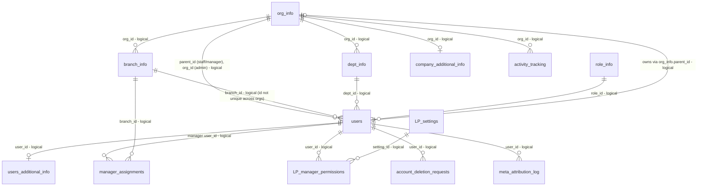
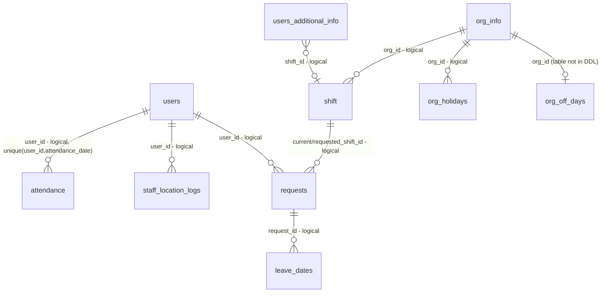
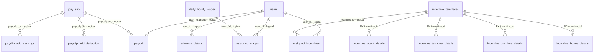
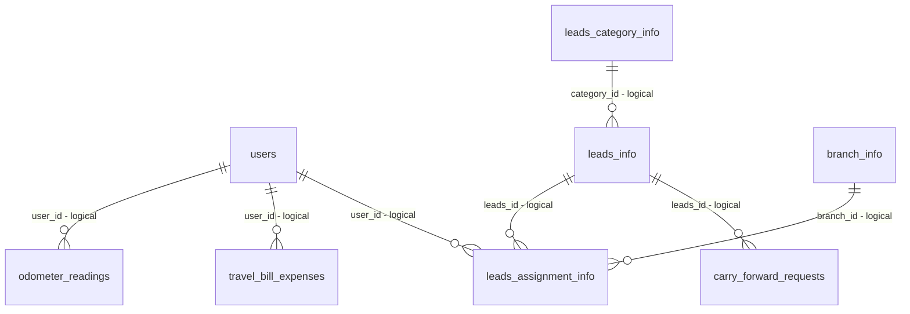
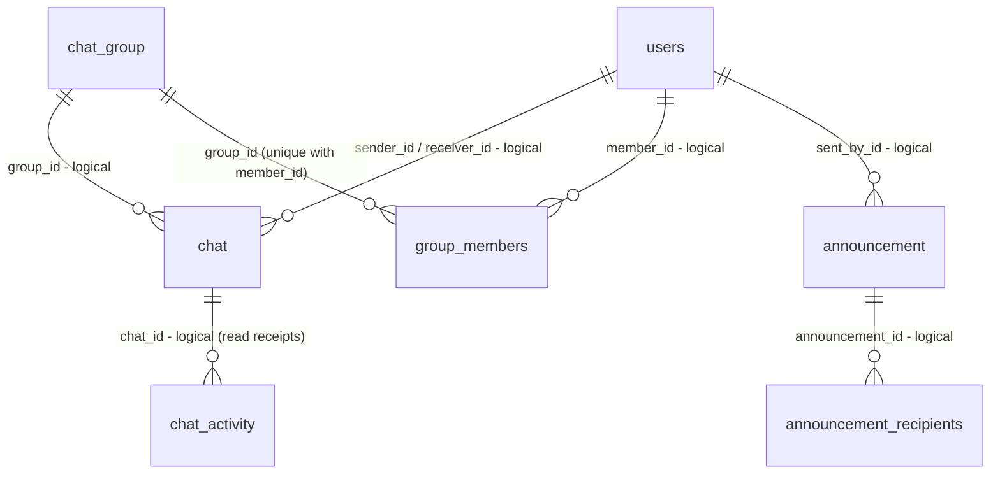
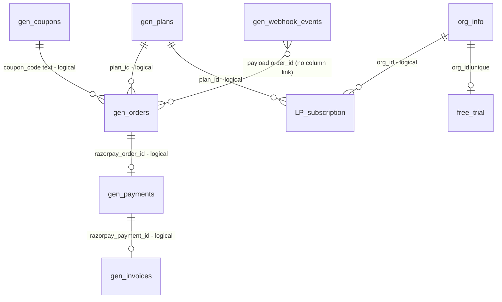
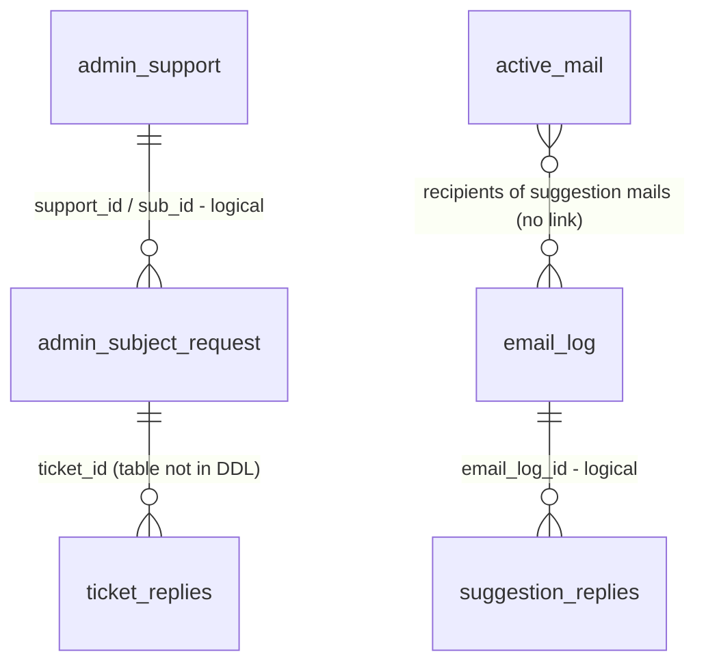

# Database schema and data dictionary

Source of truth used here: the full DDL file in the repository root (the "root DDL file", 43 KB, generated by a DB client from the production schema; every object is schema-qualified with the legacy schema name, see `rename_inventory.md`), cross-checked against every SQL statement in `core_functions/`, `router/`, `utils/` and against the earlier design DDL and migrations that exist only in git history. Naming: the three tables that carry the legacy product prefix are shown here as `LP_manager_permissions`, `LP_settings`, `LP_subscription` (`LP_` = legacy product prefix; the real names are in `rename_inventory.md`).

**DDL status (updated by the Step-1 DDL work).** `punchapp_ddl_latest.sql` is now written to run top to bottom on an EMPTY database: it creates the schema `punchapp_prod`, the three enum types, 67 tables (62 + `app_version_control`, `attendance_rule`, `org_off_days`, `salary_payments`, `ticket_replies`), the four foreign keys (declared after all tables), the sequence `gen_invoice_seq`, the drift columns of Appendix A of the gap analysis and an idempotent seed section at the end (`role_info`, `gen_plans` with placeholder prices, ten manager permission names, `app_version_control` for android/ios). Notes in this file that describe the dump "as generated" (62 tables, missing objects, the unverified enum labels, `gen_invoices` without primary key) describe the state before this change; the enum labels are now fixed in the file. Validation: **static only** (PostgreSQL parser plus a simulated catalog: 195 statements, 0 errors; details and the code-versus-DDL mismatch list in `ddl_crosscheck.md`). **Executed on an empty database: NOT RUN** (no local PostgreSQL was available). Owner commands: `createdb -h HOST -U USER clockyn_new` then `psql -h HOST -U USER -d clockyn_new -v ON_ERROR_STOP=1 -f punchapp_ddl_latest.sql`; expected afterwards in schema `punchapp_prod`: 67 tables, 3 enum types, 181 indexes (115 `CREATE INDEX` + 60 primary keys + 6 unique constraints), 64 sequences (1 explicit + 57 identity + 6 serial), 4 foreign keys, seed rows role_info 3, gen_plans 3, punchapp_settings 10, app_version_control 2. Run the app with `DB_SCHEMA=punchapp_prod`.

Database engine: PostgreSQL (RDS). The app connects with `search_path` set from env `DB_SCHEMA` (`core_functions/db_function.py:25-38,59-62`), so code uses unqualified table names; one place qualifies with the schema (`core_functions/gen_dashboard_functions.py:128`).

## 1. Summary

| Item | Value |
|---|---|
| Tables in the root DDL file | 62 |
| Tables/objects used by code but **missing** from the DDL | 3 tables (`app_version_control`, `ticket_replies`, `org_off_days`), 1 sequence (`gen_invoice_seq`), 3 enum types, columns: `gen_orders.coupon_code`, `gen_invoices.coupon_code`, `org_holidays.block_attendance`, `admin_subject_request.user_id` |
| Code writes columns that do not exist in the DDL | `activity_tracking(changed_by, status)` (`gen_dashboard_functions.py:128`), `branch_info(branch_latitude, branch_longitude)` (`add_staff_function.py:550-552`, a dead branch of staff update) |
| Real foreign keys | 4 (all four `incentive_*_details.incentive_id -> incentive_templates.incentive_id`) |
| Tables without a PRIMARY KEY constraint | 8: active_mail, admin_subject_request, admin_support, advance_details, email_log, gen_admin_login, gen_invoices, org_holidays |
| Tables with no secondary index (only PK or nothing) | 15: active_mail, admin_subject_request, admin_support, advance_details, announcement_recipients, assigned_incentives, assigned_wages, chat_activity, email_log, gen_admin_login, gen_invoices, gen_razorpay_key, payslip_add_deduction, payslip_add_earnings, LP_settings |
| `timestamp` (no time zone) columns | 98 columns in 52 tables; `timestamptz` columns: 7 in 4 tables (attendance, chat, meta_attribution_log, users.device_token_expires_at) |
| Tenant tables carrying `org_id` | 36; of these `org_id` is nullable in 21 |
| `numeric` money/quantity columns | 30 (DB side is exact; Python side uses `float`) |
| Identifiers | `id` surrogate int identity everywhere + business ids as `varchar(36)` uuid strings (`user_id`, `org_id`, ...) or small ints (`branch_id`, `shift_id`, `plan_id`, `coupon_id`, `setting_id`, `role_id`) |

### 1.1 Conventions

| Convention | Detail |
|---|---|
| Tenant key | `org_id` (uuid string). Staff/managers store it in `users.parent_id` (not `users.org_id`). |
| Status columns | Mixed: ints (`users.status` 1 active / 0 inactive / 2 deleted; `org_info`, `branch_info`, `dept_info`, `shift`, `group`, `group_members` 1/0; `gen_coupons`, `gen_razorpay_key`, `admin_support` 1/0) and strings (`requests`, `leave_dates`, `leads_*`, `odometer_readings`, `travel_bill_expenses`, `carry_forward_requests`, `admin_subject_request`, `LP_subscription`, `order_status` enum). |
| Soft delete | Only `users.status` (0/2), `group_members.status`, `org_info.status`. Almost everything else is a **hard DELETE** (43 distinct tables are deleted from, e.g. `branch_info`, `dept_info`, `shift`, `pay_slip`, `leads_info`, `chat`, `attendance` on company/account delete). `status = 1` filters on `branch_info/dept_info/shift` exist but nothing sets them to 0. |
| Time | UTC everywhere by intent (`utils/timezone.py:1-8`): `get_utc_now()` returns an aware UTC datetime. `timestamp` columns receive that value and PostgreSQL drops the zone after converting to the **session** time zone, so they are correct only while the RDS `timezone` parameter is UTC (UNVERIFIED). `attendance_date`, plan/trial dates use the UTC/server date, not IST. |
| IDs | uuid4 strings generated in Python; some integer business ids use `SELECT MAX(x)+1` (race conditions): `branch_id`, `shift_id`, `plan_id`, `coupon_id`, wage `temp_name`. |
| Geometry | `point` columns store (x = longitude, y = latitude): `branch_info.gps_location`, `attendance.*_location`, `staff_location_logs.location`. `org_info` uses two `numeric(10,6)` columns instead. |
| Files | Binary data is in S3 (see overall_context.md); the DB keeps keys or 7-day presigned URLs (`attendance.punchinface/punchoutface`, legacy `chat.file_url`). |

## 2. Entity-relationship diagrams (logical, grouped by domain)

Only 4 of these relationships are enforced by FOREIGN KEYs (marked `FK`); all others are logical links by string/int id used in JOINs (marked `logical`). Entity `chat_group` is the table named `group`.

### 2.1 Tenancy, identity, permissions

### 2.2 Time, attendance, requests

### 2.3 Payroll, wages, incentives, advances

### 2.4 Expenses and CRM

### 2.5 Chat and announcements

### 2.6 Plans, subscriptions, billing

### 2.7 Support and feedback

## 3. Enum-like values (what the integers/strings mean)

| Table.column | Values | Source |
|---|---|---|
| `users.role_id` | 1 admin (org owner), 2 manager, 3 staff | `README.md:165-169`, `auth_function.py` role checks |
| `users.status` | 1 active, 0 inactive, 2 deleted | `auth_function.py:565-569`, `gen_dashboard_functions.py:105-123`, `add_staff_function.py:643` |
| `users.is_field_staff` | 0 office staff (geofenced), 1 field staff (no geofence) | `face_attendance_functions.py:164-176` |
| `org_info.status` | 1 active, 0 inactive/deleted by operator | `gen_dashboard_functions.py:120-124` |
| `branch_info / dept_info / shift / group / group_members .status` | 1 active, 0 removed (only group_members actually soft-removes) | filters `status = 1` throughout |
| `requests.request_type (enum)` | leave, permission, device_change, shift_change | earlier design DDL, `requests_functions.py:152,186` |
| `requests.status / leave_dates.status / carry_forward_requests.status` | pending, approved, rejected | `requests_functions.py:434`, `leads_functions.py:402` |
| `leads_info.status` | new, contacted, interested, converted, not_interested (DDL default `pending`, `varchar(10)`) | `leads_functions.py:448` |
| `leads_assignment_info.status` | pending, working, completed, carry_forward | `leads_functions.py:238` |
| `odometer_readings.status / travel_bill_expenses.status` | pending, approved, rejected | `emp_expenses_functions.py:426,572` |
| `travel_bill_expenses.expense_type` | TRAVEL, BILL | `emp_expenses_functions.py:274` |
| `daily_hourly_wages.temp_type` | D daily, H hourly | `daily_hourly_functions.py:10` |
| `incentive_templates.type (enum)` | COUNT, TURNOVER, OVERTIME, BONUS | earlier design DDL |
| `gen_orders.status / gen_payments.status (enum order_status)` | CREATED, PENDING, FAILED, ATTEMPTED, PAID, REFUNDED, CANCELLED (code uses PAID, FAILED, CREATED, PENDING) | earlier design DDL, `gen_webhook_functions.py` |
| `LP_subscription.status` | ACTIVE, INACTIVE, EXPIRED (EXPIRED never written; derived from end_date) | `gen_plans_functions.py:45,77`, `gen_payment_functions.py:107` |
| `gen_plans.plan_id` | 1 Core, 2 Prime, 3 Elite (feature gating) | `gen_plans_functions.py:159-161` |
| `announcement.target` | all, selected, branch, dept | `announcement_functions.py:20-26` |
| `chat.message_type` | text, image, file | `router/chat.py:114-115` |
| `admin_subject_request.status` | created, in_progress, resolved | `support_functions.py:30,87-90` |
| `account_deletion_requests.status` | pending (others UNVERIFIED) | DDL default |
| `gen_admin_login.role_id` | 1 = operator admin (manage operators); others read-only | `router/auth.py:168-184` |

## 4. Data dictionary (all tables)

Column notation: type as in the DDL (`int4` = integer, `int2` = smallint, `varchar(n)`, `timestamp` = without time zone, `timestamptz`, `point` = (x,y)); `identity` = generated integer key; "Null" = nullable. `Code refs` = number of SQL mentions in the code base (a rough usage signal).

### 1. Tenancy, identity, permissions

#### `branch_info`

**Purpose.** Branches with GPS centre and punch radius (geofence).  
**Domains.** org_structure_company_branch_dept  
**Code refs.** 66: home_functions.py (12), add_staff_function.py (10), branch_functions.py (10), chat_functions.py (5)

| Column | Type | Null | Default | Notes |
|---|---|---|---|---|
| id | int4 | NO |  | PK; identity (always) |
| org_id | varchar(36) | yes |  |  |
| branch_id | int4 | yes |  |  |
| branch_name | varchar(255) | NO |  |  |
| branch_address | varchar(255) | NO |  |  |
| gps_location | point | NO |  |  |
| status | int4 | yes | `1` |  |
| created_at | timestamp | yes |  |  |
| updated_at | timestamp | yes |  |  |
| punch_radius | int4 | yes | `100` |  |

**Keys / constraints.** `branch_info_pkey PRIMARY KEY (id)`  
**Indexes.** `idx_branch_info_branch_id` (branch_id); `idx_branch_info_org_id` (org_id); `idx_branch_info_status` (status)

**Notes / risks.** `branch_id` is a small int that is **not globally unique**: registration numbers 1..n per org (`auth_function.py:393-400`), `add_staff` uses per-org MAX+1 (`add_staff_function.py:342,545`), `branch_functions.py:83` and `company_functions.py:62,292` use a *global* MAX+1. `users.branch_id` references it without org context. `gps_location` is a `point` (x = longitude, y = latitude; read as `gps_location[0]` = lng, `[1]` = lat, `branch_functions.py:132`). Registration stores `POINT(0,0)` and the geofence is skipped when lat/lng are falsy (`face_attendance_functions.py:170,177`). `punch_radius` metres, default 100. `status` default 1; delete is a hard `DELETE` (`branch_functions.py:208-248`).

#### `company_additional_info`

**Purpose.** Statutory extras of an organisation (PAN, CIN, TAN, MSME, website, business category, GST).  
**Domains.** org_structure_company_branch_dept  
**Code refs.** 11: company_functions.py (8), auth_function.py (1), report_functions.py (1), email.py (1)

| Column | Type | Null | Default | Notes |
|---|---|---|---|---|
| id | int4 | NO |  | PK; identity (always) |
| user_id | varchar(36) | yes |  |  |
| org_id | varchar(36) | yes |  |  |
| pan_number | varchar(10) | NO |  |  |
| company_website | varchar(255) | NO |  |  |
| cin_number | varchar(21) | NO |  |  |
| tan_number | varchar(10) | NO |  |  |
| msme_number | varchar(25) | NO |  |  |
| business_category | varchar(255) | NO |  |  |
| created_at | timestamp | yes |  |  |
| updated_at | timestamp | yes |  |  |
| gst_number | varchar(15) | yes |  |  |

**Keys / constraints.** `company_additional_info_pkey PRIMARY KEY (id)`  
**Indexes.** `idx_company_additional_org_id` (org_id); `idx_company_additional_user_id` (user_id)

**Notes / risks.** All of `pan_number, company_website, cin_number, tan_number, msme_number, business_category` are `NOT NULL`; code writes empty strings (`auth_function.py:442`). No unique(org_id).

#### `dept_info`

**Purpose.** Departments per organisation.  
**Domains.** org_structure_company_branch_dept  
**Code refs.** 69: home_functions.py (15), add_staff_function.py (9), dept_functions.py (8), company_functions.py (6)

| Column | Type | Null | Default | Notes |
|---|---|---|---|---|
| id | int4 | NO |  | PK; identity (always) |
| org_id | varchar(36) | yes |  |  |
| dept_id | varchar(50) | yes |  |  |
| dept_name | varchar(50) | NO |  |  |
| status | int4 | yes | `1` |  |
| created_at | timestamp | yes |  |  |
| updated_at | timestamp | yes |  |  |

**Keys / constraints.** `dept_info_pkey PRIMARY KEY (id)`  
**Indexes.** `idx_dept_info_dept_id` (dept_id); `idx_dept_info_org_id` (org_id); `idx_dept_info_status` (status)

**Notes / risks.** `dept_id` is a uuid string (varchar(50)). A department named `General` is created at registration. `status` default 1 but delete is a hard delete that silently NULLs `users.dept_id` (`core_functions/dept_functions.py:132`).

#### `email_otp_verification`

**Purpose.** E-mail OTP store (same shape as the mobile one).  
**Domains.** identity_auth_onboarding  
**Code refs.** 0

| Column | Type | Null | Default | Notes |
|---|---|---|---|---|
| id | int4 | NO |  | PK; identity (always) |
| email | varchar(255) | NO |  |  |
| otp_code | int4 | NO |  |  |
| is_verified | bool | yes | `false` |  |
| attempts | int4 | NO |  |  |
| created_at | timestamp | yes |  |  |
| expires_at | timestamp | yes |  |  |

**Keys / constraints.** `email_otp_verification_pkey PRIMARY KEY (id)`  
**Indexes.** `idx_email_otp_email` (email); `idx_email_otp_expires` (expires_at)

**Notes / risks.** Selected dynamically through a whitelist map (`auth_function.py:22-26`). Same caveats.

#### `otp_send_log`

**Purpose.** One row per OTP code sent through `POST /auth/generate-otp` (either channel); read by the send throttle (`OTP_MAX_PER_HOUR` / `OTP_MIN_GAP_SECONDS`). Added with `migrations/024_otp_send_log.sql`; the application prunes rows older than 24 h whenever it inserts one.  
**Domains.** identity_auth_onboarding  
**Code refs.** `core_functions/auth_function.py` (`_check_otp_send_throttle`, `_log_otp_send`, `_unlog_otp_send`)

| Column | Type | Null | Default | Notes |
|---|---|---|---|---|
| id | int4 | NO |  | PK; identity (always) |
| contact | varchar(255) | NO |  | mobile number, or the e-mail address lower-cased |
| sent_at | timestamptz | NO | `now()` |  |

**Keys / constraints.** `otp_send_log_pkey PRIMARY KEY (id)`  
**Indexes.** `idx_otp_send_log_contact_sent` (contact, sent_at)

**Notes / risks.** The row is inserted in the same transaction as the stored code and removed again when the e-mail send fails in e-mail mode, so a failed send does not use up the quota. Bypass numbers (OTP_BYPASS) are never logged.

#### `manager_assignments`

**Purpose.** Manager scope: which branch (and optionally department) a manager manages.  
**Domains.** managers_shifts_holidays  
**Code refs.** 11: manager_functions.py (6), add_staff_function.py (3), requests_functions.py (1), report.py (1)

| Column | Type | Null | Default | Notes |
|---|---|---|---|---|
| id | int4 | NO |  | PK; identity (always) |
| org_id | varchar(36) | NO |  |  |
| user_id | varchar(36) | NO |  |  |
| branch_id | int4 | NO |  |  |
| dept_id | varchar(50) | yes |  |  |
| created_at | timestamp | yes | `CURRENT_TIMESTAMP` |  |
| updated_at | timestamp | yes | `CURRENT_TIMESTAMP` |  |

**Keys / constraints.** `manager_assignments_pkey PRIMARY KEY (id)`  
**Indexes.** `manager_assignments_unique` (unique) (user_id, branch_id, COALESCE(dept_id, ''::character varying))

**Notes / risks.** `dept_id` NULL = all departments of the branch. Unique expression index `(user_id, branch_id, COALESCE(dept_id,''))`. Rewritten wholesale by `assign_manager` (`core_functions/manager_functions.py`).

#### `moblie_otp_verification`

**Purpose.** SMS OTP store (table name has a typo, kept by code). One row per mobile; replaced on every request.  
**Domains.** identity_auth_onboarding  
**Code refs.** 4: auth.py (4)

| Column | Type | Null | Default | Notes |
|---|---|---|---|---|
| id | int4 | NO |  | PK; identity (always) |
| mobile_number | varchar(255) | NO |  |  |
| otp_code | int4 | NO |  |  |
| is_verified | bool | yes | `false` |  |
| attempts | int4 | NO |  |  |
| created_at | timestamp | yes |  |  |
| expires_at | timestamp | yes |  |  |

**Keys / constraints.** `moblie_otp_verification_pkey PRIMARY KEY (id)`  
**Indexes.** `idx_mobile_otp_expires` (expires_at); `idx_mobile_otp_mobile` (mobile_number)

**Notes / risks.** `otp_code` int stored in plaintext; `attempts` incremented on failure, blocks at 5 (`auth_function.py:585-595,697-714`). `is_verified` is never set to true. `created_at/expires_at` are `timestamp` (no zone) holding UTC. Expired rows are never purged (only overwritten).

#### `org_info`

**Purpose.** One row per organisation (tenant). `org_id` (uuid string) is the tenant key used by almost every table. `parent_id` = `users.user_id` of the owning admin (role 1).  
**Domains.** identity_auth_onboarding, org_structure_company_branch_dept, platform_admin_dashboard  
**Code refs.** 60: gen_dashboard_functions.py (15), company_functions.py (12), auth_function.py (7), emp_expenses_functions.py (5)

| Column | Type | Null | Default | Notes |
|---|---|---|---|---|
| id | int4 | NO |  | PK; identity (always) |
| org_id | varchar(36) | yes |  | UNIQUE |
| org_name | varchar(255) | NO |  |  |
| org_address | varchar(255) | NO |  |  |
| org_latitude | numeric(10, 6) | NO |  |  |
| org_longitude | numeric(10, 6) | NO |  |  |
| org_gst | varchar(255) | yes |  |  |
| parent_id | varchar(36) | yes |  |  |
| status | int4 | yes | `1` |  |
| created_at | timestamp | yes |  |  |
| updated_at | timestamp | yes |  |  |
| state | varchar(100) | yes |  |  |
| district | varchar(100) | yes |  |  |
| pincode | numeric(6) | yes |  |  |

**Keys / constraints.** `org_info_pkey PRIMARY KEY (id)`  
**Indexes.** `idx_org_info_org_id` (org_id); `idx_org_info_parent_id` (parent_id); `idx_org_info_status` (status); `org_info_org_id_unique` (unique) (org_id)

**Notes / risks.** status: 1 = active, 0 = inactive/deleted (operator console maps "delete" to 0, `core_functions/gen_dashboard_functions.py:120-124`). Registration inserts `org_latitude/org_longitude = 0` placeholders (`core_functions/auth_function.py:387`). `pincode` is `numeric(6)`. `org_gst` free text. Unique on `org_id` (`org_info_org_id_unique`).

#### `LP_manager_permissions`

**Purpose.** Per-manager permission grants (`setting_id` -> settings table, `status` 1 = granted).  
**Domains.** managers_shifts_holidays  
**Code refs.** 11: manager_functions.py (5), auth_function.py (2), permission_checker.py (2), add_staff_function.py (1)

| Column | Type | Null | Default | Notes |
|---|---|---|---|---|
| id | int4 | NO |  | PK; identity (always) |
| org_id | varchar(36) | yes |  |  |
| user_id | varchar(36) | yes |  |  |
| setting_id | int4 | yes |  |  |
| status | int4 | yes | `1` |  |
| created_at | timestamp | yes | `CURRENT_TIMESTAMP` |  |
| updated_at | timestamp | yes | `CURRENT_TIMESTAMP` |  |

**Keys / constraints.** `LP_manager_permissions_pkey PRIMARY KEY (id)`  
**Indexes.** `idx_manager_permissions_org_id` (org_id); `idx_manager_permissions_setting_id` (setting_id); `idx_manager_permissions_user_id` (user_id)

**Notes / risks.** Rewritten (delete + insert) on save (`core_functions/manager_functions.py:286-310`). Checked by `check_manager_permission_middleware` (`core_functions/permission_checker.py:7-44`) — used by only 2 routes (`router/report.py:118,146`); most manager screens are gated client-side only.

#### `LP_settings`

**Purpose.** Master list of manager permission names (seed data).  
**Domains.** managers_shifts_holidays  
**Code refs.** 9: manager_functions.py (3), permission_checker.py (3), auth_function.py (2), manager.py (1)

| Column | Type | Null | Default | Notes |
|---|---|---|---|---|
| id | int4 | NO |  | PK; identity (always) |
| setting_id | int4 | yes |  |  |
| setting_name | varchar(255) | NO |  |  |
| created_at | timestamp | yes | `CURRENT_TIMESTAMP` |  |
| updated_at | timestamp | yes | `CURRENT_TIMESTAMP` |  |

**Keys / constraints.** `LP_settings_pkey PRIMARY KEY (id)`  
**Indexes.** none

**Notes / risks.** Names used in code: Staff Management, Branch Management, Department Management, Attendance Reports, Payroll Management, Holiday Management, Shift Management, Leads Management, Incentive Management, Company Settings (`core_functions/permission_checker.py:76-120`). Seed rows are not in the repo (UNVERIFIED how they were inserted).

#### `role_info`

**Purpose.** Role dictionary (role_id 1 admin, 2 manager, 3 staff).  
**Domains.** identity_auth_onboarding  
**Code refs.** 8: chat_functions.py (3), home_functions.py (2), add_staff_function.py (1), emp_pers_detail_functions.py (1)

| Column | Type | Null | Default | Notes |
|---|---|---|---|---|
| id | int4 | NO |  | PK; identity (always) |
| role_id | int4 | yes |  |  |
| role_name | varchar(50) | NO |  |  |
| description | varchar(255) | NO |  |  |
| created_at | timestamp | yes |  |  |
| updated_at | timestamp | yes |  |  |

**Keys / constraints.** `role_info_pkey PRIMARY KEY (id)`  
**Indexes.** `idx_role_info_role_id` (role_id)

**Notes / risks.** Referenced only for display names; roles are hard-coded as integers in code. No unique(role_id).

#### `users`

**Purpose.** All people: admins (role 1), managers (role 2), staff (role 3). Also stores the single active device session (`device_token`, `device_token_expires_at`) and the push token.  
**Domains.** identity_auth_onboarding, staff_management, managers_shifts_holidays, push_notifications_fcm  
**Code refs.** 224: add_staff_function.py (26), auth_function.py (22), home_functions.py (18), gen_dashboard_functions.py (16)

| Column | Type | Null | Default | Notes |
|---|---|---|---|---|
| id | int4 | NO |  | PK; identity (always) |
| user_id | varchar(36) | NO |  | UNIQUE |
| org_id | varchar(36) | yes |  | UNIQUE |
| name | varchar(50) | NO |  |  |
| emp_id | varchar(50) | NO |  |  |
| branch_id | int4 | yes |  |  |
| role_id | int4 | yes |  |  |
| dept_id | varchar(50) | yes |  |  |
| parent_id | varchar(36) | yes |  |  |
| mobile_number | varchar(255) | NO |  |  |
| email | varchar(50) | NO |  |  |
| status | int4 | yes | `1` |  |
| created_at | timestamp | yes |  |  |
| updated_at | timestamp | yes |  |  |
| device_token | varchar(36) | yes |  |  |
| is_field_staff | int4 | yes | `0` |  |
| push_token | text | yes |  |  |
| meta_campaign_id | varchar(255) | yes |  |  |
| meta_adset_id | varchar(255) | yes |  |  |
| meta_ad_id | varchar(255) | yes |  |  |
| install_source | varchar(255) | yes |  |  |
| attribution_platform | varchar(50) | yes |  |  |
| device_token_expires_at | timestamptz | yes |  |  |

**Keys / constraints.** `users_pkey PRIMARY KEY (id)`  
**Indexes.** `idx_users_branch_id` (branch_id); `idx_users_dept_id` (dept_id); `idx_users_email` (email); `idx_users_mobile` (mobile_number); `idx_users_org_id` (org_id); `idx_users_org_role_status` (org_id, role_id, status); `idx_users_parent_id` (parent_id); `idx_users_role_status` (role_id, status); `idx_users_user_id` (user_id); `users_org_id_key` (unique) (org_id); `users_user_id_key` (unique) (user_id)

**Notes / risks.** `status`: 1 active, 0 inactive, 2 deleted (`core_functions/auth_function.py:565-569`). Admins: `org_id` set, `parent_id` NULL. Managers/staff: `org_id` NULL and `parent_id` = org id (`core_functions/add_staff_function.py:397-402`); `add_staff` also accepts a client-supplied `parent_id` (`:393`), so the column is overloaded (org id vs. manager id). `device_token` is a plaintext uuid compared in `verify_device_token` (`auth_function.py:772-900`); expiry 90 days written at login (`:729`) but only enforced in `verify_device_token`. `is_field_staff` 0/1 (field staff skip the geofence, `face_attendance_functions.py:164-176`). `mobile_number` is not unique (index only) although login does `LIMIT 1` by mobile (`auth_function.py:954-1010`). `users_org_id_key` is a UNIQUE index on `org_id`: harmless while only admins carry `org_id` but it forbids ever setting `org_id` on staff. Attribution columns written by `/attribution/meta`.

#### `users_additional_info`

**Purpose.** HR/PII profile of a user: bank, identity numbers, DOB, emergency contact, `shift_id` (the only shift assignment), joining date.  
**Domains.** employee_profile_version_attribution, staff_management  
**Code refs.** 23: home_functions.py (5), add_staff_function.py (4), emp_pers_detail_functions.py (4), company_functions.py (2)

| Column | Type | Null | Default | Notes |
|---|---|---|---|---|
| id | int4 | NO |  | PK; identity (always) |
| user_id | varchar(36) | yes |  |  |
| acc_no | varchar(20) | NO |  |  |
| ifsc_code | varchar(20) | NO |  |  |
| bank_name | varchar(100) | NO |  |  |
| bank_branch | varchar(100) | NO |  |  |
| dob | date | yes |  |  |
| gender | varchar(20) | NO |  |  |
| blood_group | varchar(5) | yes |  |  |
| address | varchar(255) | NO |  |  |
| emergency_contact_no | varchar(15) | NO |  |  |
| shift_id | int4 | yes |  |  |
| father_name | varchar(100) | yes |  |  |
| marital_status | varchar(20) | yes |  |  |
| aadhaar_no | varchar(12) | yes |  |  |
| pan_no | varchar(10) | yes |  |  |
| uan_no | varchar(20) | yes |  |  |
| pf_no | varchar(50) | yes |  |  |
| esi_no | varchar(50) | yes |  |  |
| doj | date | yes |  |  |
| created_at | timestamp | yes | `CURRENT_TIMESTAMP` |  |
| updated_at | timestamp | yes | `CURRENT_TIMESTAMP` |  |

**Keys / constraints.** `users_additional_info_pkey PRIMARY KEY (id)`  
**Indexes.** `idx_users_additional_shift_id` (shift_id); `idx_users_additional_user_id` (user_id)

**Notes / risks.** No unique(user_id): one row per user is enforced only by exists-checks (`core_functions/emp_pers_detail_functions.py:170-197`). Several `NOT NULL` text columns (`acc_no`, `ifsc_code`, `bank_name`, `bank_branch`, `gender`, `address`, `emergency_contact_no`) force placeholder strings. Aadhaar/PAN/UAN/PF/ESI/bank data stored in plaintext. `shift_id` has no FK. Personal-details update prints the whole payload including these fields to stdout (`emp_pers_detail_functions.py:182-184`).

### 2. Time, attendance, requests

#### `attendance`

**Purpose.** One row per punch **session** (punch-in/punch-out pair). Code allows 2 sessions per user per day.  
**Domains.** attendance_and_home, face_recognition_punch  
**Code refs.** 49: home_functions.py (18), face_attendance_functions.py (9), gen_dashboard_functions.py (9), attendance_functions.py (4)

| Column | Type | Null | Default | Notes |
|---|---|---|---|---|
| id | int4 | NO |  | PK; identity (always) |
| user_id | varchar(36) | NO |  |  |
| org_id | varchar(36) | NO |  |  |
| attendance_date | date | NO |  |  |
| punch_in | timestamptz | yes |  |  |
| punch_out | timestamptz | yes |  |  |
| work_hours | numeric(5, 2) | yes |  |  |
| created_at | timestamptz | yes |  |  |
| updated_at | timestamptz | yes |  |  |
| punch_in_location | point | yes |  |  |
| punch_out_location | point | yes |  |  |
| punchinface | text | yes |  |  |
| punchoutface | text | yes |  |  |
| face_mismatch | bool | yes | `false` |  |

**Keys / constraints.** `attendance_pkey PRIMARY KEY (id)`  
**Indexes.** `attendance_user_id_attendance_date_key` (unique) (user_id, attendance_date); `idx_attendance_date` (attendance_date); `idx_attendance_org_date` (org_id, attendance_date); `idx_attendance_org_id` (org_id); `idx_attendance_user_date` (user_id, attendance_date); `idx_attendance_user_id` (user_id)

**Notes / risks.** Punch-in inserts a row; punch-out updates it (`core_functions/face_attendance_functions.py:186-231` insert, `:321` punch-out update). `attendance_date` = **UTC** date of the punch (`:181`, so 00:00-05:30 IST lands on the previous day). `punch_in/punch_out` timestamptz UTC. `work_hours numeric(5,2)`. `punch_in_location/punch_out_location` = `point` (x = longitude, y = latitude, `:214`). `punchinface/punchoutface` hold **7-day presigned S3 URLs** (text) later re-signed on read (`ml/s3.py:401-423`). `face_mismatch` true when `force_accept` skipped matching. **Conflict:** unique index `(user_id, attendance_date)` (`attendance_user_id_attendance_date_key`) makes a 2nd session of the same day impossible, while code allows 2 (`face_attendance_functions.py:205-209`) and `edit_attendance` upserts on that very key (`attendance_functions.py:314-321`). Verify the live index before relying on either. Duplicate/overlapping indexes: `idx_attendance_user_date` duplicates the unique index; `idx_attendance_org_id`, `idx_attendance_user_id` are prefixes of composite ones.

#### `firm_holidays`

**Purpose.** Legacy holiday table, replaced by `org_holidays`; only deleted when a company is deleted (`core_functions/company_functions.py:452`).  
**Domains.** org_structure_company_branch_dept  
**Code refs.** 1: company_functions.py (1)

| Column | Type | Null | Default | Notes |
|---|---|---|---|---|
| id | int4 | NO |  | PK; identity (always) |
| org_id | varchar(36) | yes |  |  |
| holiday_id | varchar(36) | NO |  |  |
| holiday_name | varchar(50) | NO |  |  |
| holiday_date | date | NO |  |  |
| created_at | timestamp | yes |  |  |
| updated_at | timestamp | yes |  |  |

**Keys / constraints.** `firm_holidays_pkey PRIMARY KEY (id)`  
**Indexes.** `idx_firm_holidays_date` (holiday_date); `idx_firm_holidays_org_id` (org_id)

**Notes / risks.** Dead data; candidate for drop.

#### `leave_dates`

**Purpose.** One row per requested leave date with its own decision.  
**Domains.** requests_and_approvals  
**Code refs.** 10: requests_functions.py (8), add_staff_function.py (1), company_functions.py (1)

| Column | Type | Null | Default | Notes |
|---|---|---|---|---|
| id | int4 | NO |  | PK; identity (always) |
| request_id | varchar(36) | yes |  |  |
| leave_date | date | NO |  |  |
| created_at | timestamp | yes | `CURRENT_TIMESTAMP` |  |
| updated_at | timestamp | yes | `CURRENT_TIMESTAMP` |  |
| status | varchar(20) | yes | `'pending'` |  |
| action_by | varchar(36) | yes |  |  |
| action_at | timestamp | yes |  |  |

**Keys / constraints.** `leave_dates_pkey PRIMARY KEY (id)`  
**Indexes.** `idx_leave_dates_leave_date` (leave_date); `idx_leave_dates_request_id` (request_id)

**Notes / risks.** `request_id` -> `requests.request_id` (no FK). `status` pending | approved | rejected; `action_by`, `action_at`.

#### `org_holidays`

**Purpose.** Organisation holidays (current table). Scope by branch/department **name** (NULL = all).  
**Domains.** managers_shifts_holidays  
**Code refs.** 6: holiday_functions.py (6)

| Column | Type | Null | Default | Notes |
|---|---|---|---|---|
| id | int4 | NO |  | serial |
| org_id | varchar(36) | NO |  |  |
| name | varchar(100) | NO |  |  |
| date | date | NO |  |  |
| branch_name | varchar(100) | yes |  |  |
| dept_name | varchar(100) | yes |  |  |
| created_at | timestamp | yes | `now()` |  |

**Keys / constraints.** (none declared)  
**Indexes.** `idx_org_holidays_org_date` (org_id, date)

**Notes / risks.** **Schema drift:** code also writes `block_attendance boolean NOT NULL DEFAULT TRUE` (`core_functions/holiday_functions.py:73`), added by a migration that is absent from this DDL (it existed in a deleted `change_db` script, see migrations_and_changes.md). `id serial` without a PRIMARY KEY constraint.

#### `requests`

**Purpose.** Staff requests: leave, permission, shift change, device change.  
**Domains.** requests_and_approvals  
**Code refs.** 17: requests_functions.py (12), add_staff_function.py (2), company_functions.py (2), gen_dashboard_functions.py (1)

| Column | Type | Null | Default | Notes |
|---|---|---|---|---|
| id | int4 | NO |  | PK; identity (always) |
| user_id | varchar(36) | NO |  |  |
| org_id | varchar(36) | NO |  |  |
| request_id | varchar(36) | yes |  | UNIQUE |
| request_type | "request_type_enum" | NO |  |  |
| reason | text | yes |  |  |
| permission_start_time | time | yes |  |  |
| permission_end_time | time | yes |  |  |
| current_shift_id | int4 | yes |  |  |
| requested_shift_id | int4 | yes |  |  |
| shift_change_date | date | yes |  |  |
| status | varchar(20) | yes | `'pending'` |  |
| action_by | varchar(36) | yes |  |  |
| action_at | timestamp | yes |  |  |
| created_at | timestamp | yes | `CURRENT_TIMESTAMP` |  |
| updated_at | timestamp | yes | `CURRENT_TIMESTAMP` |  |
| new_device_token | varchar(255) | yes |  |  |

**Keys / constraints.** `requests_pkey PRIMARY KEY (id)`  
**Indexes.** `idx_requests_org_id` (org_id); `idx_requests_request_id` (request_id); `idx_requests_status` (status); `idx_requests_type` (request_type); `idx_requests_user_id` (user_id); `requests_request_id_key` (unique) (request_id)

**Notes / risks.** `request_type` enum `request_type_enum` = leave | permission | device_change | shift_change. `status` text pending | approved | rejected (`core_functions/requests_functions.py:434`); for leave the request-level status is never updated (only `leave_dates.status`). `request_id` uuid (unique). `new_device_token` used by device_change. `current_shift_id/requested_shift_id` reference `shift.shift_id` without FK.

#### `shift`

**Purpose.** Shift definitions per organisation (name, start, end).  
**Domains.** managers_shifts_holidays  
**Code refs.** 22: shift_functions.py (7), home_functions.py (4), requests_functions.py (3), company_functions.py (2)

| Column | Type | Null | Default | Notes |
|---|---|---|---|---|
| id | int4 | NO |  | PK; identity (always) |
| shift_id | int4 | yes |  | UNIQUE |
| shift_name | varchar(100) | NO |  |  |
| start_time | time | NO |  |  |
| end_time | time | NO |  |  |
| status | int4 | yes | `1` |  |
| created_at | timestamp | yes | `CURRENT_TIMESTAMP` |  |
| updated_at | timestamp | yes | `CURRENT_TIMESTAMP` |  |
| org_id | varchar(36) | yes |  |  |

**Keys / constraints.** `shift_pkey PRIMARY KEY (id)`  
**Indexes.** `idx_shift_org_id` (org_id); `idx_shift_shift_id` (shift_id); `idx_shift_status` (status); `shift_shift_id_org_id_unique` (unique) (shift_id, org_id); `unique_shift_id` (unique) (shift_id)

**Notes / risks.** `shift_id` int generated as global `MAX+1` (`core_functions/shift_functions.py:77`) — racy; unique on `shift_id` alone (`unique_shift_id`) and on `(shift_id, org_id)`. `end_time < start_time` means an overnight shift; validation rejects computed duration > 18 h only on create/update (`shift_functions.py:42-62`), 6 of the 75 active shifts in the exported CSV (parent-folder `Shift Issue`, 5 Sept) exceed 18 h; `fix.sql` holds the detection query. Hard delete.

#### `staff_location_logs`

**Purpose.** GPS breadcrumbs of field staff (also one row at each punch-in).  
**Domains.** staff_location, face_recognition_punch  
**Code refs.** 10: staff_location_functions.py (6), face_attendance_functions.py (2), add_staff_function.py (1), home_functions.py (1)

| Column | Type | Null | Default | Notes |
|---|---|---|---|---|
| id | int4 | NO |  | PK; identity (always) |
| user_id | varchar(36) | NO |  |  |
| org_id | varchar(36) | NO |  |  |
| location | point | NO |  |  |
| date_time | timestamp | yes | `CURRENT_TIMESTAMP` |  |

**Keys / constraints.** `staff_location_logs_pkey PRIMARY KEY (id)`  
**Indexes.** `idx_staff_location_logs_org_date` (org_id, date_time DESC); `idx_staff_location_logs_user_date` (user_id, date_time DESC); `idx_staff_location_logs_user_datetime` (user_id, date_time)

**Notes / risks.** `location` point (x = longitude, y = latitude). `date_time` is `timestamp` without zone, UTC. Grows unbounded: only `DELETE /staff-location/cleanup` removes rows (unauthenticated, no scheduler).

### 3. Payroll, wages, incentives

#### `advance_details`

**Purpose.** Salary advances (amount, date) per user.  
**Domains.** reports_and_advance  
**Code refs.** 8: advance_functions.py (6), add_staff_function.py (1), report_functions.py (1)

| Column | Type | Null | Default | Notes |
|---|---|---|---|---|
| id | int4 | NO |  | identity (by default) |
| advance_id | int4 | yes |  |  |
| advance_amt | numeric(10, 2) | NO |  |  |
| date | date | NO |  |  |
| user_id | varchar(36) | yes |  |  |
| created_by | varchar(36) | yes |  |  |
| org_id | varchar(36) | yes |  |  |

**Keys / constraints.** (none declared)  
**Indexes.** none

**Notes / risks.** `advance_id` is set equal to `id` after insert (`core_functions/advance_functions.py:55-58`); **no primary key**, no unique on `advance_id`. No amount validation (negative allowed).

#### `assigned_incentives`

**Purpose.** User -> incentive template assignment.  
**Domains.** incentives  
**Code refs.** 11: incentive_functions.py (8), report_functions.py (2), add_staff_function.py (1)

| Column | Type | Null | Default | Notes |
|---|---|---|---|---|
| id | int4 | NO |  | PK; identity (always) |
| org_id | varchar(36) | NO |  |  |
| user_id | varchar(36) | NO |  |  |
| incentive_id | varchar(36) | NO |  |  |
| created_at | timestamp | yes | `CURRENT_TIMESTAMP` |  |
| updated_at | timestamp | yes | `CURRENT_TIMESTAMP` |  |

**Keys / constraints.** `assigned_incentives_pkey PRIMARY KEY (id)`  
**Indexes.** none

**Notes / risks.** No unique(user_id, incentive_id); no FK to templates.

#### `assigned_wages`

**Purpose.** User -> wage template assignment (`temp_id`).  
**Domains.** wages_daily_hourly  
**Code refs.** 9: daily_hourly_functions.py (6), report_functions.py (2), add_staff_function.py (1)

| Column | Type | Null | Default | Notes |
|---|---|---|---|---|
| id | int4 | NO |  | PK; identity (always) |
| org_id | varchar(36) | NO |  |  |
| user_id | varchar(36) | NO |  |  |
| temp_id | varchar(36) | NO |  |  |
| created_at | timestamp | yes | `CURRENT_TIMESTAMP` |  |
| updated_at | timestamp | yes | `CURRENT_TIMESTAMP` |  |

**Keys / constraints.** `assigned_wages_pkey PRIMARY KEY (id)`  
**Indexes.** none

**Notes / risks.** No unique(user_id, temp_id); the "one template per type" rule lives in code.

#### `daily_hourly_wages`

**Purpose.** Daily (`D`) and hourly (`H`) wage templates **and** per-user copies.  
**Domains.** wages_daily_hourly  
**Code refs.** 15: daily_hourly_functions.py (11), report_functions.py (2), add_staff_function.py (1), company_functions.py (1)

| Column | Type | Null | Default | Notes |
|---|---|---|---|---|
| id | int4 | NO |  | PK; identity (always) |
| org_id | varchar(36) | yes |  |  |
| temp_id | varchar(36) | yes |  |  |
| temp_name | varchar(100) | NO |  |  |
| temp_type | varchar(1) | NO |  |  |
| temp_amount | numeric(10, 2) | yes |  |  |
| att_bandwidth | int4 | yes |  |  |
| created_at | timestamp | yes | `CURRENT_TIMESTAMP` |  |
| updated_at | timestamp | yes | `CURRENT_TIMESTAMP` |  |
| user_id | varchar(36) | yes |  |  |

**Keys / constraints.** `daily_hourly_wages_pkey PRIMARY KEY (id)`  
**Indexes.** `idx_daily_hourly_wages_org_id` (org_id); `idx_daily_hourly_wages_temp_id` (temp_id)

**Notes / risks.** `temp_type` `D`/`H`. Rows with `user_id IS NULL` are templates, rows with `user_id` set are per-user copies created on assignment (`core_functions/daily_hourly_functions.py:25,174`). `temp_name` is an auto-incremented numeric string ("1","2"...) computed with MAX (`:46`). `att_bandwidth` is never populated. Live router missing (see endpoint catalogue).

#### `incentive_bonus_details`

**Purpose.** BONUS rule (`bonus_percent`, `month` varchar(15), `year`).  
**Domains.** incentives  
**Code refs.** 13: incentive_functions.py (10), add_staff_function.py (1), company_functions.py (1), report_functions.py (1)

| Column | Type | Null | Default | Notes |
|---|---|---|---|---|
| id | int4 | NO |  | PK; identity (always) |
| incentive_id | varchar(36) | yes |  | FK -> incentive_templates(incentive_id) |
| bonus_percent | numeric(5, 2) | NO |  |  |
| month | varchar(15) | yes |  |  |
| year | int4 | yes |  |  |
| user_id | varchar(36) | yes |  |  |

**Keys / constraints.** `incentive_bonus_details_pkey PRIMARY KEY (id)`  
**Foreign keys.** `incentive_bonus_details_incentive_id_fkey`: incentive_id -> incentive_templates(incentive_id)  
**Indexes.** `idx_incentive_bonus_incentive_id` (incentive_id)

**Notes / risks.** FK as above. `month` free text.

#### `incentive_count_details`

**Purpose.** COUNT incentive rule (`count_upto_basic_salary`, `next_count`, `each_incentive`).  
**Domains.** incentives  
**Code refs.** 12: incentive_functions.py (9), add_staff_function.py (1), company_functions.py (1), report_functions.py (1)

| Column | Type | Null | Default | Notes |
|---|---|---|---|---|
| id | int4 | NO |  | PK; identity (always) |
| incentive_id | varchar(36) | yes |  | FK -> incentive_templates(incentive_id) |
| count_upto_basic_salary | int4 | NO |  |  |
| next_count | int4 | NO |  |  |
| each_incentive | numeric(12, 2) | NO |  |  |
| user_id | varchar(36) | yes |  |  |

**Keys / constraints.** `incentive_count_details_pkey PRIMARY KEY (id)`  
**Foreign keys.** `incentive_count_details_incentive_id_fkey`: incentive_id -> incentive_templates(incentive_id)  
**Indexes.** `idx_incentive_count_incentive_id` (incentive_id)

**Notes / risks.** FK -> `incentive_templates(incentive_id)`. `user_id IS NULL` = template row.

#### `incentive_overtime_details`

**Purpose.** OVERTIME rule (`duration_minutes`, `amount`).  
**Domains.** incentives  
**Code refs.** 12: incentive_functions.py (9), add_staff_function.py (1), company_functions.py (1), report_functions.py (1)

| Column | Type | Null | Default | Notes |
|---|---|---|---|---|
| id | int4 | NO |  | PK; identity (always) |
| incentive_id | varchar(36) | yes |  | FK -> incentive_templates(incentive_id) |
| duration_minutes | int4 | NO |  |  |
| amount | numeric(12, 2) | NO |  |  |
| user_id | varchar(36) | yes |  |  |

**Keys / constraints.** `incentive_overtime_details_pkey PRIMARY KEY (id)`  
**Foreign keys.** `incentive_overtime_details_incentive_id_fkey`: incentive_id -> incentive_templates(incentive_id)  
**Indexes.** `idx_incentive_overtime_incentive_id` (incentive_id)

**Notes / risks.** FK as above.

#### `incentive_templates`

**Purpose.** Incentive template header. `type` enum `incentive_type` = COUNT | TURNOVER | OVERTIME | BONUS (values from the earlier design DDL in git history; UNVERIFIED against the live enum).  
**Domains.** incentives  
**Code refs.** 23: incentive_functions.py (14), company_functions.py (6), report_functions.py (2), add_staff_function.py (1)

| Column | Type | Null | Default | Notes |
|---|---|---|---|---|
| id | int4 | NO |  | PK; identity (always) |
| org_id | varchar(36) | yes |  |  |
| user_id | varchar(36) | yes |  |  |
| type | "incentive_type" | NO |  |  |
| template_name | varchar(150) | NO |  |  |
| created_at | timestamp | yes | `CURRENT_TIMESTAMP` |  |
| updated_at | timestamp | yes | `CURRENT_TIMESTAMP` |  |
| incentive_id | varchar(36) | yes |  | UNIQUE |

**Keys / constraints.** `incentive_templates_pkey PRIMARY KEY (id)`  
**Indexes.** `idx_incentive_templates_incentive_id` (incentive_id); `idx_incentive_templates_org_id` (org_id); `idx_incentive_templates_user_id` (user_id); `incentive_templates_incentive_id_key` (unique) (incentive_id)

**Notes / risks.** `incentive_id` uuid, unique; target of 4 real foreign keys.

#### `incentive_turnover_details`

**Purpose.** TURNOVER rule (`turnover_upto_basic_salary`, `after_target_incentive_percent`).  
**Domains.** incentives  
**Code refs.** 12: incentive_functions.py (9), add_staff_function.py (1), company_functions.py (1), report_functions.py (1)

| Column | Type | Null | Default | Notes |
|---|---|---|---|---|
| id | int4 | NO |  | PK; identity (always) |
| incentive_id | varchar(36) | yes |  | FK -> incentive_templates(incentive_id) |
| turnover_upto_basic_salary | numeric(14, 2) | NO |  |  |
| after_target_incentive_percent | numeric(5, 2) | NO |  |  |
| user_id | varchar(36) | yes |  |  |

**Keys / constraints.** `incentive_turnover_details_pkey PRIMARY KEY (id)`  
**Foreign keys.** `incentive_turnover_details_incentive_id_fkey`: incentive_id -> incentive_templates(incentive_id)  
**Indexes.** `idx_incentive_turnover_incentive_id` (incentive_id)

**Notes / risks.** FK as above.

#### `pay_slip`

**Purpose.** Salary templates (monthly structure): basic, HRA, EPF, professional tax, health insurance.  
**Domains.** salary_and_payslips  
**Code refs.** 12: salary_structure.py (7), company_functions.py (3), report_functions.py (2)

| Column | Type | Null | Default | Notes |
|---|---|---|---|---|
| id | int4 | NO |  | PK; identity (always) |
| pay_slip_id | varchar(36) | yes |  |  |
| pay_slip_name | varchar(255) | yes |  |  |
| org_id | varchar(36) | yes |  |  |
| basic_pay | numeric(10, 2) | yes |  |  |
| hra | numeric(10, 2) | yes |  |  |
| epf | numeric(10, 2) | yes |  |  |
| professional_tax | numeric(10, 2) | yes |  |  |
| created_at | timestamp | yes |  |  |
| updated_at | timestamp | yes |  |  |
| health_insurance | numeric(10, 2) | yes |  |  |

**Keys / constraints.** `pay_slip_pkey PRIMARY KEY (id)`  
**Indexes.** `idx_pay_slip_org_id` (org_id); `idx_pay_slip_pay_slip_id` (pay_slip_id)

**Notes / risks.** `pay_slip_id` uuid (not unique-constrained; only indexed). Hard delete leaves `payroll` rows dangling (`core_functions/salary_structure.py:286-331`). Money columns are `numeric(10,2)` but arithmetic in Python uses `float` (83 `float(` calls in `core_functions`).

#### `payroll`

**Purpose.** Assignment: one pay slip template per user.  
**Domains.** salary_and_payslips  
**Code refs.** 9: salary_structure.py (5), report_functions.py (2), add_staff_function.py (1), company_functions.py (1)

| Column | Type | Null | Default | Notes |
|---|---|---|---|---|
| id | int4 | NO |  | PK; identity (always) |
| org_id | varchar(36) | yes |  |  |
| user_id | varchar(36) | NO |  | UNIQUE |
| pay_slip_id | varchar(36) | yes |  |  |
| created_at | timestamp | yes |  |  |
| updated_at | timestamp | yes |  |  |

**Keys / constraints.** `payroll_pkey PRIMARY KEY (id)`  
**Indexes.** `idx_payroll_org_id` (org_id); `idx_payroll_pay_slip_id` (pay_slip_id); `idx_payroll_user_id` (user_id); `payroll_user_id_key` (unique) (user_id)

**Notes / risks.** Unique on `user_id` (`payroll_user_id_key`).

#### `payslip_add_deduction`

**Purpose.** Custom deduction lines of a template.  
**Domains.** salary_and_payslips  
**Code refs.** 9: salary_structure.py (6), report_functions.py (2), company_functions.py (1)

| Column | Type | Null | Default | Notes |
|---|---|---|---|---|
| id | int4 | NO |  | PK; identity (always) |
| pay_slip_id | varchar(36) | yes |  |  |
| add_deduction_name | varchar(255) | yes |  |  |
| add_deduction_amount | numeric(10, 2) | yes |  |  |
| created_at | timestamp | yes |  |  |
| updated_at | timestamp | yes |  |  |

**Keys / constraints.** `payslip_add_deduction_pkey PRIMARY KEY (id)`  
**Indexes.** none

**Notes / risks.** Link by `pay_slip_id`, no FK.

#### `payslip_add_earnings`

**Purpose.** Custom earning lines of a template.  
**Domains.** salary_and_payslips  
**Code refs.** 9: salary_structure.py (6), report_functions.py (2), company_functions.py (1)

| Column | Type | Null | Default | Notes |
|---|---|---|---|---|
| id | int4 | NO |  | PK; identity (always) |
| pay_slip_id | varchar(36) | yes |  |  |
| add_earnings_name | varchar(255) | yes |  |  |
| add_earnings_amount | numeric(10, 2) | yes |  |  |
| created_at | timestamp | yes |  |  |
| updated_at | timestamp | yes |  |  |

**Keys / constraints.** `payslip_add_earnings_pkey PRIMARY KEY (id)`  
**Indexes.** none

**Notes / risks.** Link by `pay_slip_id`, no FK.

### 4. Expenses

#### `odometer_readings`

**Purpose.** Daily start/stop odometer reading of field staff with computed distance and (stamped) allowance rate.  
**Domains.** expenses  
**Code refs.** 15: emp_expenses_functions.py (11), report_functions.py (2), add_staff_function.py (1), company_functions.py (1)

| Column | Type | Null | Default | Notes |
|---|---|---|---|---|
| id | int4 | NO |  | PK; identity (always) |
| user_id | varchar(36) | NO |  |  |
| org_id | varchar(36) | NO |  |  |
| reading_date | date | NO |  |  |
| start_km | numeric(10, 2) | yes |  |  |
| stop_km | numeric(10, 2) | yes |  |  |
| distance_km | numeric(10, 2) | yes |  |  |
| status | varchar(20) | yes | `'pending'` |  |
| created_at | timestamp | yes | `CURRENT_TIMESTAMP` |  |
| updated_at | timestamp | yes | `CURRENT_TIMESTAMP` |  |
| readings_id | varchar(36) | yes |  | UNIQUE |
| allowance_rate | int4 | yes |  |  |

**Keys / constraints.** `odometer_readings_pkey PRIMARY KEY (id)`  
**Indexes.** `idx_odometer_readings_date` (reading_date); `idx_odometer_readings_org_id` (org_id); `idx_odometer_readings_readings_id` (readings_id); `idx_odometer_readings_user_id` (user_id); `odometer_readings_readings_id_key` (unique) (readings_id)

**Notes / risks.** `status` pending | approved | rejected (`core_functions/emp_expenses_functions.py:426`). `allowance_rate int` (whole rupees; also used as the org-wide rate store: `save_allowance_rate` updates every row, `:470-483`). `readings_id` uuid unique.

#### `travel_bill_expenses`

**Purpose.** Travel/bill expense claims.  
**Domains.** expenses  
**Code refs.** 8: emp_expenses_functions.py (4), report_functions.py (2), add_staff_function.py (1), company_functions.py (1)

| Column | Type | Null | Default | Notes |
|---|---|---|---|---|
| id | int4 | NO |  | PK; identity (always) |
| user_id | varchar(36) | NO |  |  |
| org_id | varchar(36) | NO |  |  |
| expense_date | date | NO |  |  |
| expense_type | varchar(20) | NO |  |  |
| amount | numeric(12, 2) | NO |  |  |
| status | varchar(20) | yes | `'pending'` |  |
| created_at | timestamp | yes | `CURRENT_TIMESTAMP` |  |
| updated_at | timestamp | yes | `CURRENT_TIMESTAMP` |  |
| expense_id | varchar(36) | yes |  |  |

**Keys / constraints.** `travel_bill_expenses_pkey PRIMARY KEY (id)`  
**Indexes.** `idx_travel_bill_expenses_date` (expense_date); `idx_travel_bill_expenses_expense_id` (expense_id); `idx_travel_bill_expenses_org_id` (org_id); `idx_travel_bill_expenses_user_id` (user_id)

**Notes / risks.** `expense_type` `TRAVEL` | `BILL` (upper-cased, `emp_expenses_functions.py:274,301`); `status` pending | approved | rejected; `expense_id` uuid (indexed, not unique).

### 5. CRM

#### `carry_forward_requests`

**Purpose.** Staff request to carry a lead over to another date; admin approves/rejects.  
**Domains.** crm_leads  
**Code refs.** 9: leads_functions.py (9)

| Column | Type | Null | Default | Notes |
|---|---|---|---|---|
| id | int4 | NO |  | PK; identity (always) |
| request_id | varchar(36) | NO |  | UNIQUE |
| leads_id | varchar(36) | NO |  |  |
| org_id | varchar(36) | NO |  |  |
| user_id | varchar(36) | NO |  |  |
| description | text | yes |  |  |
| request_date | date | NO |  |  |
| status | varchar(10) | yes | `'pending'` |  |
| actioned_by | varchar(36) | yes |  |  |
| actioned_at | timestamp | yes |  |  |
| created_at | timestamp | yes | `CURRENT_TIMESTAMP` |  |

**Keys / constraints.** `carry_forward_requests_pkey PRIMARY KEY (id)`  
**Indexes.** `carry_forward_requests_request_id_key` (unique) (request_id)

**Notes / risks.** Created at runtime by `CREATE TABLE IF NOT EXISTS` in three handlers (`leads_functions.py:274,324,366`). `status` pending | approved | rejected. No unique on (leads_id, user_id, pending) -> duplicates possible.

#### `leads_assignment_info`

**Purpose.** Lead assignment to users with work status.  
**Domains.** crm_leads  
**Code refs.** 13: leads_functions.py (11), add_staff_function.py (1), company_functions.py (1)

| Column | Type | Null | Default | Notes |
|---|---|---|---|---|
| id | int4 | NO |  | PK; identity (always) |
| leads_id | varchar(36) | yes |  |  |
| assignment_id | varchar(36) | yes |  |  |
| org_id | varchar(36) | yes |  |  |
| branch_id | int4 | yes |  |  |
| dept_id | varchar(50) | yes |  |  |
| user_id | varchar(36) | NO |  |  |
| remarks | varchar(255) | yes |  |  |
| status | varchar(20) | yes | `'pending'` |  |
| created_at | timestamp | yes |  |  |
| updated_at | timestamp | yes |  |  |
| description | text | yes |  |  |
| request_date | date | yes |  |  |

**Keys / constraints.** `leads_assignment_info_pkey PRIMARY KEY (id)`  
**Indexes.** `idx_leads_assignment_leads_id` (leads_id); `idx_leads_assignment_org_id` (org_id); `idx_leads_assignment_org_status` (org_id, status); `idx_leads_assignment_status` (status); `idx_leads_assignment_user_id` (user_id)

**Notes / risks.** `status` here is the work status `pending | working | completed | carry_forward` (`leads_functions.py:238`). `description`, `request_date` and `status varchar(20)` were applied at **runtime** by `ALTER TABLE` inside a request handler (`leads_functions.py:288-289`). `GET /api/leads` joins this table so a lead assigned to n users yields n rows.

#### `leads_category_info`

**Purpose.** Lead categories per organisation.  
**Domains.** crm_leads  
**Code refs.** 11: leads_functions.py (10), company_functions.py (1)

| Column | Type | Null | Default | Notes |
|---|---|---|---|---|
| id | int4 | NO |  | PK; identity (always) |
| category_id | varchar(36) | NO |  | UNIQUE |
| category_name | varchar(100) | NO |  |  |
| org_id | varchar(36) | yes |  |  |
| created_at | timestamp | yes | `CURRENT_TIMESTAMP` |  |
| updated_at | timestamp | yes | `CURRENT_TIMESTAMP` |  |

**Keys / constraints.** `leads_category_info_pkey PRIMARY KEY (id)`  
**Indexes.** `idx_leads_category_category_id` (category_id); `idx_leads_category_org_id` (org_id); `leads_category_info_category_id_key` (unique) (category_id)

**Notes / risks.** `category_id` uuid unique.

#### `leads_info`

**Purpose.** Leads (customers).  
**Domains.** crm_leads  
**Code refs.** 10: leads_functions.py (9), company_functions.py (1)

| Column | Type | Null | Default | Notes |
|---|---|---|---|---|
| id | int4 | NO |  | PK; identity (always) |
| leads_id | varchar(36) | yes |  |  |
| org_id | varchar(36) | yes |  |  |
| client_name | varchar(100) | yes |  |  |
| mobile_number | varchar(15) | yes |  |  |
| client_address | varchar(255) | NO |  |  |
| category_id | varchar(36) | NO |  |  |
| remarks | varchar(255) | yes |  |  |
| created_at | timestamp | yes |  |  |
| updated_at | timestamp | yes |  |  |
| status | varchar(10) | yes | `'pending'` |  |
| created_date | date | yes |  |  |

**Keys / constraints.** `leads_info_pkey PRIMARY KEY (id)`  
**Indexes.** `idx_leads_info_category_id` (category_id); `idx_leads_info_leads_id` (leads_id); `idx_leads_info_org_id` (org_id)

**Notes / risks.** `status varchar(10)` default `pending`, but code validates `new | contacted | interested | converted | not_interested` (`core_functions/leads_functions.py:448`): `not_interested` has 14 characters and overflows `varchar(10)`; the default `pending` is not in the allowed set. `created_date` holds the customer **required date** (naming only). `client_name/mobile_number` PII.

### 6. Chat and announcements

#### `announcement`

**Purpose.** Announcements broadcast by an admin.  
**Domains.** announcements  
**Code refs.** 9: chat_functions.py (5), announcement_functions.py (4)

| Column | Type | Null | Default | Notes |
|---|---|---|---|---|
| id | int4 | NO |  | PK; identity (always) |
| announcement_id | varchar(36) | yes |  | UNIQUE |
| announcement_type | varchar(10) | yes | `'text'` |  |
| message | text | yes |  |  |
| org_id | varchar(36) | yes |  |  |
| branch_id | int4 | yes |  |  |
| dept_id | varchar(36) | yes |  |  |
| created_at | timestamp | yes | `CURRENT_TIMESTAMP` |  |
| updated_at | timestamp | yes | `CURRENT_TIMESTAMP` |  |
| title | varchar(100) | yes |  |  |
| target | varchar(20) | yes | `'all'` |  |
| sent_by_id | varchar(36) | yes |  |  |

**Keys / constraints.** `announcement_pkey PRIMARY KEY (id)`  
**Indexes.** `announcement_announcement_id_key` (unique) (announcement_id)

**Notes / risks.** `target` all | selected | branch | dept (`core_functions/announcement_functions.py`); `announcement_type` default text. `announcement_id` uuid unique. No index on `org_id`/`created_at`. Admin check by DB lookup of `sent_by_id` (`announcement_functions.py:32-38`).

#### `announcement_recipients`

**Purpose.** Recipients of `selected`-target announcements.  
**Domains.** announcements  
**Code refs.** 5: announcement_functions.py (4), add_staff_function.py (1)

| Column | Type | Null | Default | Notes |
|---|---|---|---|---|
| id | int4 | NO |  | PK; identity (always) |
| announcement_id | varchar(36) | NO |  |  |
| user_id | varchar(36) | NO |  |  |
| created_at | timestamp | yes | `CURRENT_TIMESTAMP` |  |

**Keys / constraints.** `announcement_recipients_pkey PRIMARY KEY (id)`  
**Indexes.** none

**Notes / risks.** No indexes, no unique(announcement_id, user_id).

#### `chat`

**Purpose.** Chat messages, 1:1 (`receiver_id`) and group (`group_id`).  
**Domains.** chat_and_groups  
**Code refs.** 18: chat_functions.py (13), add_staff_function.py (3), chat.py (2)

| Column | Type | Null | Default | Notes |
|---|---|---|---|---|
| id | int4 | NO |  | PK; identity (always) |
| chat_id | varchar(36) | yes |  | UNIQUE |
| message_type | varchar(10) | yes | `'text'` |  |
| message | text | yes |  |  |
| date_time | timestamptz | yes | `CURRENT_TIMESTAMP` |  |
| group_id | varchar(36) | yes |  |  |
| sender_id | varchar(36) | yes |  |  |
| receiver_id | varchar(36) | yes |  |  |
| file_url | text | yes |  |  |

**Keys / constraints.** `chat_pkey PRIMARY KEY (id)`  
**Indexes.** `chat_chat_id_key` (unique) (chat_id)

**Notes / risks.** `message_type` text | image | file (`router/chat.py:114-115`). `file_url` holds an S3 **key** (new rows) or a stored presigned URL (legacy rows), resolved by `get_chat_file_presigned_url` (`ml/s3.py:252-283`). `date_time` timestamptz. **Indexes: only unique(chat_id)** — no index on `sender_id`, `receiver_id`, `group_id` or `date_time`, so every list/history query is a sequential scan.

#### `chat_activity`

**Purpose.** Read receipts: one row per (message, receiver) with `seen_at`; `group_id` set for group messages.  
**Domains.** chat_and_groups  
**Code refs.** 13: chat_functions.py (12), add_staff_function.py (1)

| Column | Type | Null | Default | Notes |
|---|---|---|---|---|
| id | int4 | NO |  | PK; identity (always) |
| chat_id | varchar(36) | yes |  |  |
| group_id | varchar(36) | yes |  |  |
| receiver_id | varchar(36) | yes |  |  |
| seen_at | timestamp | yes |  |  |

**Keys / constraints.** `chat_activity_pkey PRIMARY KEY (id)`  
**Indexes.** none

**Notes / risks.** No indexes at all, no unique(chat_id, receiver_id) (dedup done in code, `core_functions/chat_functions.py:318,546`).

#### `group`

**Purpose.** Chat groups (table name is the SQL reserved word `group`, always quoted).  
**Domains.** chat_and_groups  
**Code refs.** 0

| Column | Type | Null | Default | Notes |
|---|---|---|---|---|
| id | int4 | NO |  | PK; identity (always) |
| group_id | varchar(36) | yes |  | UNIQUE |
| user_id | varchar(36) | yes |  |  |
| org_id | varchar(36) | yes |  |  |
| group_name | varchar(255) | yes |  |  |
| status | int4 | yes | `1` |  |
| created_at | timestamp | yes | `CURRENT_TIMESTAMP` |  |
| updated_at | timestamp | yes | `CURRENT_TIMESTAMP` |  |

**Keys / constraints.** `group_pkey PRIMARY KEY (id)`  
**Indexes.** `group_group_id_key` (unique) (group_id)

**Notes / risks.** `user_id` = creator. `group_id` uuid unique. `status` 1 active. In the ERD below it is drawn as `chat_group`.

#### `group_members`

**Purpose.** Group membership.  
**Domains.** chat_and_groups  
**Code refs.** 13: chat_functions.py (9), chat.py (3), add_staff_function.py (1)

| Column | Type | Null | Default | Notes |
|---|---|---|---|---|
| id | int4 | NO |  | PK; identity (always) |
| group_id | varchar(36) | yes |  |  |
| member_id | varchar(36) | yes |  |  |
| status | int4 | yes | `1` |  |
| created_at | timestamp | yes | `CURRENT_TIMESTAMP` |  |
| updated_at | timestamp | yes | `CURRENT_TIMESTAMP` |  |

**Keys / constraints.** `group_members_pkey PRIMARY KEY (id)`; `uq_group_members_group_member UNIQUE (group_id, member_id)`  
**Indexes.** none

**Notes / risks.** `status` 1 = member, 0 = removed (soft). Unique `(group_id, member_id)`.

### 7. Plans, subscriptions, billing

#### `free_trial`

**Purpose.** One-month free trial per organisation.  
**Domains.** plans_subscriptions_billing  
**Code refs.** 7: gen_plans_functions.py (3), auth_function.py (2), gen_dashboard_functions.py (1), gen_payment_functions.py (1)

| Column | Type | Null | Default | Notes |
|---|---|---|---|---|
| id | int4 | NO |  | PK; identity (by default) |
| org_id | varchar(36) | NO |  | UNIQUE |
| user_id | varchar(36) | NO |  |  |
| start_date | date | NO |  |  |
| end_date | date | NO |  |  |
| is_active | bool | yes | `true` |  |
| created_at | timestamp | yes | `CURRENT_TIMESTAMP` |  |

**Keys / constraints.** `free_trial_org_id_key UNIQUE (org_id)`; `free_trial_pkey PRIMARY KEY (id)`  
**Indexes.** none

**Notes / risks.** Unique `org_id`. `end_date = start + 1 month`, compared to `date.today()` (server date, UTC in containers) (`auth_function.py:451-457`, `gen_plans_functions.py:57`). No staff limit during trial.

#### `gen_coupons`

**Purpose.** Discount coupons (name, discount percent).  
**Domains.** plans_subscriptions_billing  
**Code refs.** 6: gen_plans_functions.py (6)

| Column | Type | Null | Default | Notes |
|---|---|---|---|---|
| id | int4 | NO |  | PK; identity (by default) |
| coupon_id | int4 | yes |  | UNIQUE |
| coupon_name | varchar(50) | NO |  |  |
| discount | numeric(5, 2) | NO |  |  |
| status | int2 | yes | `1` |  |
| created_at | timestamp | yes | `CURRENT_TIMESTAMP` |  |
| updated_at | timestamp | yes | `CURRENT_TIMESTAMP` |  |

**Keys / constraints.** `gen_coupons_coupon_id_key UNIQUE (coupon_id)`; `gen_coupons_pkey PRIMARY KEY (id)`  
**Indexes.** none

**Notes / risks.** `coupon_id` unique, `MAX+1` (`gen_plans_functions.py:265`); `status` 1 active. Coupon codes are enumerable via `GET /plans/coupon/validate`.

#### `gen_invoices`

**Purpose.** Tax invoices. Number format `INV-YYYY-NNNN` from sequence `gen_invoice_seq` (`gen_payment_functions.py:148`).  
**Domains.** orders_payments_webhooks_invoices  
**Code refs.** 7: email.py (4), gen_dashboard_functions.py (1), gen_payment_functions.py (1), gen_orders.py (1)

| Column | Type | Null | Default | Notes |
|---|---|---|---|---|
| id | int4 | NO |  | identity (by default) |
| invoice_id | varchar(36) | NO |  |  |
| invoice_number | varchar(30) | NO |  |  |
| user_id | varchar(36) | NO |  |  |
| org_id | varchar(36) | NO |  |  |
| razorpay_payment_id | varchar(40) | NO |  |  |
| razorpay_order_id | varchar(40) | yes |  |  |
| plan_name | varchar(100) | yes |  |  |
| staff_count | int4 | yes | `1` |  |
| base_amount | numeric(10, 2) | NO |  |  |
| cgst | numeric(10, 2) | NO | `0` |  |
| sgst | numeric(10, 2) | NO | `0` |  |
| total_amount | numeric(10, 2) | NO |  |  |
| payment_date | timestamp | NO |  |  |
| valid_till | date | NO |  |  |
| created_at | timestamp | yes | `CURRENT_TIMESTAMP` |  |

**Keys / constraints.** (none declared)  
**Indexes.** none

**Notes / risks.** **No primary key and no unique on `invoice_id` / `invoice_number`**; sequence `gen_invoice_seq` and column `coupon_code` (written at `gen_payment_functions.py:141-157`) are absent from this DDL. `base_amount/cgst/sgst/total_amount numeric(10,2)`; GST split hard-coded 18% (9+9) in Python float (`gen_payment_functions.py:124-126`); no IGST for out-of-state.

#### `gen_orders`

**Purpose.** Razorpay orders. `status` enum `order_status` = CREATED | PENDING | FAILED | ATTEMPTED | PAID | REFUNDED | CANCELLED (from the earlier design DDL; UNVERIFIED).  
**Domains.** orders_payments_webhooks_invoices  
**Code refs.** 11: gen_webhook_functions.py (3), gen_dashboard_functions.py (2), gen_orders_functions.py (2), gen_payment_functions.py (2)

| Column | Type | Null | Default | Notes |
|---|---|---|---|---|
| id | int4 | NO |  | PK; identity (always) |
| user_id | varchar(36) | NO |  |  |
| org_id | varchar(36) | NO |  |  |
| plan_id | int4 | NO |  |  |
| razorpay_order_id | varchar(40) | yes |  | UNIQUE |
| amount | numeric(10, 2) | NO |  |  |
| currency | varchar(10) | yes | `'INR'` |  |
| status | "order_status" | yes | `'PENDING'` |  |
| created_at | timestamp | yes | `CURRENT_TIMESTAMP` |  |
| updated_at | timestamp | yes | `CURRENT_TIMESTAMP` |  |
| staff_limit | int4 | NO | `10` |  |

**Keys / constraints.** `gen_orders_pkey PRIMARY KEY (id)`  
**Indexes.** `gen_orders_razorpay_order_id_key` (unique) (razorpay_order_id)

**Notes / risks.** **Schema drift:** code writes `coupon_code` (`core_functions/gen_orders_functions.py:96`), absent from this DDL. `amount` is the **client-supplied** grand total. `staff_limit` default 10. Unique `razorpay_order_id`.

#### `gen_payments`

**Purpose.** Verified payments (one per Razorpay payment id).  
**Domains.** orders_payments_webhooks_invoices  
**Code refs.** 6: gen_dashboard_functions.py (4), gen_payment_functions.py (1), gen_webhook_functions.py (1)

| Column | Type | Null | Default | Notes |
|---|---|---|---|---|
| id | int4 | NO |  | PK; identity (always) |
| user_id | varchar(36) | NO |  |  |
| org_id | varchar(36) | NO |  |  |
| razorpay_payment_id | varchar(40) | NO |  | UNIQUE |
| razorpay_order_id | varchar(40) | yes |  |  |
| amount | numeric(10, 2) | NO |  |  |
| status | "order_status" | yes | `'PENDING'` |  |
| created_at | timestamp | yes | `CURRENT_TIMESTAMP` |  |
| updated_at | timestamp | yes | `CURRENT_TIMESTAMP` |  |

**Keys / constraints.** `gen_payments_pkey PRIMARY KEY (id)`  
**Indexes.** `gen_payments_razorpay_payment_id_key` (unique) (razorpay_payment_id)

**Notes / risks.** Unique `razorpay_payment_id`. `org_id` is `NOT NULL` but the webhook insert omits it (`core_functions/gen_webhook_functions.py:50-55`), so the webhook path fails against this DDL.

#### `gen_plans`

**Purpose.** Plan catalogue: id, name, duration in months, price per staff (UNVERIFIED unit: code multiplies on the client).  
**Domains.** plans_subscriptions_billing  
**Code refs.** 15: gen_dashboard_functions.py (6), gen_plans_functions.py (6), gen_orders_functions.py (1), gen_payment_functions.py (1)

| Column | Type | Null | Default | Notes |
|---|---|---|---|---|
| id | int4 | NO |  | PK; identity (always) |
| plan_id | int4 | NO |  | UNIQUE |
| plan_name | varchar(100) | NO |  |  |
| plan_month | int4 | NO |  |  |
| plan_amount | numeric(10, 2) | NO |  |  |
| created_at | timestamp | yes | `CURRENT_TIMESTAMP` |  |
| updated_at | timestamp | yes | `CURRENT_TIMESTAMP` |  |

**Keys / constraints.** `gen_plans_pkey PRIMARY KEY (id)`  
**Indexes.** `gen_plans_plan_id_key` (unique) (plan_id)

**Notes / risks.** `plan_id` int unique, generated as `MAX+1` (`core_functions/gen_plans_functions.py:352`). Fixed ids with behaviour: 1 Core, 2 Prime, 3 Elite (`gen_plans_functions.py:159-161`). Hard delete.

#### `gen_razorpay_key`

**Purpose.** Razorpay API key id **and secret** stored in the database; first row with `status = 1` is used (cached 5 min, `utils/razorpay.py:42-67`).  
**Domains.** orders_payments_webhooks_invoices  
**Code refs.** 1: razorpay.py (1)

| Column | Type | Null | Default | Notes |
|---|---|---|---|---|
| id | int4 | NO |  | PK; identity (always) |
| key_id | varchar(255) | NO |  |  |
| key_secret | varchar(255) | NO |  |  |
| mode | varchar(10) | NO |  |  |
| status | int2 | yes | `1` |  |
| created_at | timestamp | yes | `CURRENT_TIMESTAMP` |  |
| updated_at | timestamp | yes | `CURRENT_TIMESTAMP` |  |

**Keys / constraints.** `gen_razorpay_key_pkey PRIMARY KEY (id)`  
**Indexes.** none

**Notes / risks.** Secret at rest in plaintext in a general table; `mode` (test/live) not consulted by code.

#### `gen_webhook_events`

**Purpose.** Raw inbound webhook payloads (Razorpay, MSG91 WhatsApp).  
**Domains.** orders_payments_webhooks_invoices  
**Code refs.** 2: gen_webhook_functions.py (2)

| Column | Type | Null | Default | Notes |
|---|---|---|---|---|
| id | int4 | NO |  | PK; identity (always) |
| event_id | varchar(255) | yes |  | UNIQUE |
| event_type | varchar(100) | NO |  |  |
| payload | jsonb | NO |  |  |
| received_at | timestamp | yes | `CURRENT_TIMESTAMP` |  |

**Keys / constraints.** `gen_webhook_events_pkey PRIMARY KEY (id)`  
**Indexes.** `gen_webhook_events_event_id_key` (unique) (event_id)

**Notes / risks.** Unique `event_id` (duplicate deliveries raise a 500 which makes the sender retry).

#### `LP_subscription`

**Purpose.** Paid subscription per organisation (history; the latest ACTIVE row wins).  
**Domains.** plans_subscriptions_billing, orders_payments_webhooks_invoices  
**Code refs.** 18: gen_dashboard_functions.py (7), gen_payment_functions.py (4), gen_plans_functions.py (4), add_staff_function.py (1)

| Column | Type | Null | Default | Notes |
|---|---|---|---|---|
| id | int4 | NO |  | PK; identity (always) |
| org_id | varchar(36) | NO |  |  |
| user_id | varchar(36) | NO |  |  |
| plan_id | int4 | NO |  |  |
| subscription_id | varchar(255) | yes |  | UNIQUE |
| status | varchar(20) | yes | `'ACTIVE'` |  |
| start_date | date | NO |  |  |
| end_date | date | NO |  |  |
| created_at | timestamp | yes | `CURRENT_TIMESTAMP` |  |
| updated_at | timestamp | yes | `CURRENT_TIMESTAMP` |  |
| staff_limit | int4 | NO | `10` |  |

**Keys / constraints.** `LP_subscription_pkey PRIMARY KEY (id)`  
**Indexes.** `LP_subscription_subscription_id_key` (unique) (subscription_id)

**Notes / risks.** `status` ACTIVE | INACTIVE | EXPIRED (`gen_plans_functions.py:45,77`); nothing flips ACTIVE to EXPIRED (computed from `end_date`). `staff_limit` default 10. `subscription_id` uuid unique. Renew with same plan adds staff and keeps `end_date` (`gen_payment_functions.py:75-92`).

### 8. Support and feedback

#### `active_mail`

**Purpose.** Recipient list (`status = 1`) for suggestion notification e-mails (`core_functions/suggest_feature_functions.py:17-20`).  
**Domains.** support_and_feedback  
**Code refs.** 1: suggest_feature_functions.py (1)

| Column | Type | Null | Default | Notes |
|---|---|---|---|---|
| id | int4 | yes |  |  |
| email | varchar(50) | yes |  |  |
| status | int4 | yes |  |  |

**Keys / constraints.** (none declared)  
**Indexes.** none

**Notes / risks.** No PK; maintained by hand in SQL.

#### `admin_subject_request`

**Purpose.** Support tickets.  
**Domains.** support_and_feedback  
**Code refs.** 8: support_functions.py (8)

| Column | Type | Null | Default | Notes |
|---|---|---|---|---|
| id | int4 | NO |  | identity (always) |
| support_id | int4 | yes |  |  |
| sub_id | varchar(36) | yes |  |  |
| org_id | varchar(36) | yes |  |  |
| client_msg | text | yes |  |  |
| status | varchar(20) | yes | `'created'` |  |
| reply | text | yes |  |  |
| created_at | timestamp | yes | `CURRENT_TIMESTAMP` |  |
| updated_at | timestamp | yes | `CURRENT_TIMESTAMP` |  |
| photo_url | text | yes |  |  |

**Keys / constraints.** (none declared)  
**Indexes.** none

**Notes / risks.** `status` created | in_progress | resolved (`core_functions/support_functions.py:30,87-90`). `photo_url` stores an S3 key. **Schema drift:** code writes `user_id` (`support_functions.py:29`), absent here (existed in a deleted `change_db` script). No PK.

#### `admin_support`

**Purpose.** Support subject catalogue (`sub_id`, `sub_name`, `status` 1 active).  
**Domains.** support_and_feedback  
**Code refs.** 6: support_functions.py (6)

| Column | Type | Null | Default | Notes |
|---|---|---|---|---|
| id | int4 | NO |  | identity (always) |
| sub_id | varchar(36) | yes |  |  |
| sub_name | varchar(255) | yes |  |  |
| status | int2 | yes | `0` |  |
| created_at | timestamp | yes | `CURRENT_TIMESTAMP` |  |
| updated_at | timestamp | yes | `CURRENT_TIMESTAMP` |  |

**Keys / constraints.** (none declared)  
**Indexes.** none

**Notes / risks.** No PK; seed rows not in repo.

#### `email_log`

**Purpose.** Feature-suggestion log (org, date, subject, text).  
**Domains.** support_and_feedback  
**Code refs.** 5: suggest_feature_functions.py (5)

| Column | Type | Null | Default | Notes |
|---|---|---|---|---|
| id | int4 | NO |  | serial |
| org_id | varchar(36) | yes |  |  |
| date | date | yes |  |  |
| subject | text | yes |  |  |
| text | text | yes |  |  |
| created_at | timestamp | yes |  |  |

**Keys / constraints.** (none declared)  
**Indexes.** none

**Notes / risks.** `id serial` without PRIMARY KEY. Users submit via `/company/suggest-feature`.

#### `suggestion_replies`

**Purpose.** Operator replies to `email_log` rows.  
**Domains.** support_and_feedback  
**Code refs.** 3: suggest_feature_functions.py (3)

| Column | Type | Null | Default | Notes |
|---|---|---|---|---|
| id | int4 | NO |  | PK; serial |
| email_log_id | int4 | NO |  |  |
| reply_text | text | NO |  |  |
| admin_name | varchar(100) | yes | `'Admin'` |  |
| created_at | timestamp | yes | `CURRENT_TIMESTAMP` |  |

**Keys / constraints.** `suggestion_replies_pkey PRIMARY KEY (id)`  
**Indexes.** `idx_suggestion_replies_log_id` (email_log_id)

**Notes / risks.** `email_log_id` -> `email_log.id` (no FK).

### 9. Platform / ops

#### `account_deletion_requests`

**Purpose.** Admin-initiated account deletion requests processed manually by operators.  
**Domains.** org_structure_company_branch_dept, platform_admin_dashboard  
**Code refs.** 4: company_functions.py (4)

| Column | Type | Null | Default | Notes |
|---|---|---|---|---|
| id | int4 | NO |  | PK; identity (by default) |
| request_id | varchar(36) | NO |  | UNIQUE |
| user_id | varchar(36) | NO |  |  |
| org_name | varchar(255) | yes |  |  |
| mobile_number | varchar(20) | yes |  |  |
| email | varchar(100) | yes |  |  |
| status | varchar(20) | yes | `'pending'` |  |
| requested_at | timestamp | yes | `CURRENT_TIMESTAMP` |  |
| actioned_at | timestamp | yes |  |  |

**Keys / constraints.** `account_deletion_requests_pkey PRIMARY KEY (id)`; `account_deletion_requests_request_id_key UNIQUE (request_id)`  
**Indexes.** none

**Notes / risks.** status default `pending`. Unique `request_id`. Read unauthenticated by `GET /company/deletion-requests`.

#### `activity_tracking`

**Purpose.** Audit trail of organisation activation / deactivation by operators.  
**Domains.** platform_admin_dashboard  
**Code refs.** 2: add_staff_function.py (1), company_functions.py (1)

| Column | Type | Null | Default | Notes |
|---|---|---|---|---|
| id | int4 | NO |  | PK; identity (always) |
| org_id | varchar(36) | yes |  |  |
| user_id | varchar(36) | yes |  |  |
| activity | varchar(100) | NO |  |  |
| created_at | timestamp | yes | `CURRENT_TIMESTAMP` |  |
| updated_at | timestamp | yes | `CURRENT_TIMESTAMP` |  |

**Keys / constraints.** `activity_tracking_pkey PRIMARY KEY (id)`  
**Indexes.** `idx_activity_tracking_created_at` (created_at); `idx_activity_tracking_org_id` (org_id); `idx_activity_tracking_user_id` (user_id)

**Notes / risks.** **Schema drift:** the DDL has `user_id, activity (NOT NULL)` but the only INSERT writes `(org_id, changed_by, status)` (`core_functions/gen_dashboard_functions.py:127-131`) — both columns are absent here, so org activate/deactivate/delete fails and rolls back if this DDL reflects production. DELETEs at `add_staff_function.py:765`, `company_functions.py:454`.

#### `gen_admin_login`

**Purpose.** Operator (platform admin) accounts for the internal console: phone, role, name.  
**Domains.** platform_admin_dashboard  
**Code refs.** 11: auth.py (9), gen_dashboard_functions.py (2)

| Column | Type | Null | Default | Notes |
|---|---|---|---|---|
| phone_number | varchar(20) | yes |  |  |
| role_id | int4 | yes |  |  |
| name | varchar(100) | yes |  |  |

**Keys / constraints.** (none declared)  
**Indexes.** none

**Notes / risks.** No primary key or unique on `phone_number` (duplicate rows possible; code only pre-checks, `router/auth.py:205-207`). role_id 1 = may manage operators; other roles read-only. Used as a header-keyed auth source (`x-admin-id`).

#### `meta_attribution_log`

**Purpose.** Append-only log of marketing attribution calls (campaign/adset/ad id per user).  
**Domains.** employee_profile_version_attribution  
**Code refs.** 1: attribution.py (1)

| Column | Type | Null | Default | Notes |
|---|---|---|---|---|
| id | int4 | NO |  | PK; serial |
| user_id | varchar(255) | NO |  |  |
| campaign_id | varchar(255) | yes |  |  |
| adset_id | varchar(255) | yes |  |  |
| ad_id | varchar(255) | yes |  |  |
| source | varchar(255) | yes | `'facebook'` |  |
| created_at | timestamptz | yes | `now()` |  |

**Keys / constraints.** `meta_attribution_log_pkey PRIMARY KEY (id)`  
**Indexes.** `idx_meta_attribution_campaign` (campaign_id); `idx_meta_attribution_created_at` (created_at); `idx_meta_attribution_user_id` (user_id)

**Notes / risks.** `user_id varchar(255)` (not 36). Written by `POST /attribution/meta` (`router/attribution.py:22`).

### Objects used by code but absent from the root DDL file

| Object | Shape (from code) | Evidence / note |
|---|---|---|
| `app_version_control` | Per-platform app version policy: `platform` (unique: android/ios), `latest_version`, `min_supported`, `force_update`, `message`, `store_url`, `updated_at`. | Read by `GET /version/check` (`router/version.py:15`). DDL recoverable from git history (`migrations/app_version_control.sql`, deleted in commit `1081288`). Single row per platform shared by every app that calls the API. |
| `ticket_replies` | Threaded replies on support tickets: `id serial`, `ticket_id int`, `reply_text`, `author_name` default Admin, `is_admin bool`, `created_at`. | Used by `core_functions/support_functions.py:80,147,195`; handlers fall back to a base query when the table is missing (`:154`). DDL only in the deleted `change_db` script. |
| `org_off_days` | Weekly off days per organisation: `org_id` (conflict target, so unique/PK), `off_days` (Python list -> most likely `int[]`, 0 = Monday ... 6 = Sunday, default `[6]` when no row). | Used by `core_functions/holiday_functions.py:13,28`; **no DDL anywhere in the repo or its git history** (UNVERIFIED column type). |
| `gen_invoice_seq` | Sequence for invoice numbers (`nextval`, `core_functions/gen_payment_functions.py:148`). | Not in the DDL; if missing, every invoice insert fails (and is swallowed after the subscription commit). |
| `enum types` | `order_status`, `incentive_type`, `request_type_enum` are referenced by columns but their `CREATE TYPE` is not in this DDL. | Values above come from the earlier design DDL (git history, deleted in commit `1081288`). |

## 5. Data-integrity and design risks (ranked)

| # | Severity | Risk | Evidence | Suggested fix |
|---|---|---|---|---|
| 1 | High | No tenant isolation in the schema: only 4 FKs exist; every cross-table link (user -> org, attendance -> user, payroll -> pay_slip ...) is an unchecked string/int. Orphans accumulate and cross-tenant references are possible. | FK scan of the root DDL (4 FKs); earlier design DDL in git history defined ~45 FKs that were never applied to production. | Add FKs in stages after a clean-up pass (`NOT VALID` then `VALIDATE`). Start with users->org_info, attendance->users, leave_dates->requests, payroll->pay_slip. |
| 2 | High | attendance unique index vs 2-sessions-per-day logic: either the second punch-in raises a unique violation (reported as a generic DB error) or the index does not exist in production. | DDL `attendance_user_id_attendance_date_key` vs `face_attendance_functions.py:205-209`, `attendance_functions.py:314-321`. | Decide the model: (a) one row per day with arrays of sessions, or (b) drop the unique index, add `session_no smallint` and a unique `(user_id, attendance_date, session_no)`; change `edit_attendance` accordingly. |
| 3 | High | Schema drift between DDL and code (missing tables/columns/sequence/enums listed in section 4). | Section 1 and "Objects used by code but absent". | Regenerate the DDL from production, commit it, and move to versioned migrations (see migrations_and_changes.md). |
| 4 | High | Money handled as Python `float` and GST computed with chained rounding; invoice, salary, advance, order amounts. | `gen_payment_functions.py:124-126`, `salary_structure.py:168-169,176-178`, 83 `float(` calls; DB columns are `numeric`. | Use `Decimal` end to end; compute GST once from the total; store `gst_rate`, `igst`. |
| 5 | High | Biometric and PII stored in plaintext / long-lived URLs: Aadhaar, PAN, bank account, IFSC, DOB (`users_additional_info`), `gen_razorpay_key.key_secret`, `users.device_token`, face images in S3 via 7-day presigned URLs stored in `attendance`. | DDL columns; `ml/s3.py:190-213`. | Encrypt sensitive columns (pgcrypto/KMS), hash device tokens, store S3 keys not URLs, move the gateway secret to a secret manager. |
| 6 | Medium | `timestamp` columns without time zone for 80+ audit/business timestamps; values depend on the DB session time zone. | Section 1 counts; `utils/timezone.py`. | Migrate to `timestamptz` (`ALTER ... TYPE timestamptz USING col AT TIME ZONE 'UTC'`). |
| 7 | Medium | Attendance date semantics: `attendance_date` stores the UTC date, so IST punches between 00:00 and 05:30 are filed under the previous day; plan/trial/holiday checks use the server date. | `face_attendance_functions.py:180-181`, `holiday_functions.py:160`, `gen_plans_functions.py:57`. | Add `org_info.timezone` (default Asia/Kolkata) and derive business dates from it. |
| 8 | Medium | Racy integer id generation with `MAX()+1` and inconsistent scopes (`branch_id` per-org in some code, global in other code). | See `branch_info`, `shift`, `gen_plans`, `gen_coupons` notes. | Use identity/sequence columns; make `(org_id, branch_id)` the key, or use uuid branch ids. |
| 9 | Medium | Missing indexes on hot tables: `chat` (sender/receiver/group/date), `chat_activity`, `announcement`, `announcement_recipients`, `advance_details`, `assigned_*`, `payslip_*`. | Index lists in section 4. | Add composite indexes: `chat(receiver_id, sender_id, date_time)`, `chat(group_id, date_time)`, `chat_activity(chat_id, receiver_id)`, `announcement(org_id, created_at)`. |
| 10 | Medium | Missing PKs / uniqueness: `gen_invoices` (invoice_number/invoice_id), `gen_admin_login.phone_number`, `advance_details`, `admin_support`, `admin_subject_request`, `email_log`, `org_holidays`, `active_mail`; `users.mobile_number` not unique while login assumes it is. | Section 1. | Add PKs and unique constraints; clean duplicates first. |
| 11 | Medium | Column length / vocabulary mismatches: `leads_info.status varchar(10)` vs `not_interested`; `users.name varchar(50)`, `users.email varchar(50)`, `holiday_name varchar(50)`; enum vs varchar status vocabularies. | Annotated per table. | Widen to `varchar(20)`/text and add CHECK constraints for status vocabularies. |
| 12 | Medium | Hard deletes cascade by hand in code (company delete touches ~25 tables, account delete fewer) and leave orphans; no soft-delete or retention policy for PII/biometrics. | `company_functions.py:408-470`, `add_staff_function.py:740-800`, `ml/s3.py:356-398`. | Introduce `deleted_at`, scheduled purge, and FK `ON DELETE CASCADE` where appropriate. |
| 13 | Low | Unbounded append tables with no retention job: `staff_location_logs`, `gen_webhook_events`, `meta_attribution_log`, expired OTP rows. | No scheduler exists in the app. | Add a nightly job (pg_cron or an external scheduler) and partition `staff_location_logs` by month. |
| 14 | Low | Duplicate/overlapping indexes (`attendance`: 6 indexes on 3 column sets; `users`: 11 indexes; `shift`: two unique indexes). | Section 4. | Drop `idx_attendance_user_date`, `idx_attendance_user_id`, `idx_attendance_org_id` (covered by composites) after checking plans. |
| 15 | Low | Legacy objects: `firm_holidays` (replaced), `email_otp_verification` shape duplicate of mobile table, typo table `moblie_otp_verification`. | Section 4. | Drop or rename during the Clockyn migration. |

