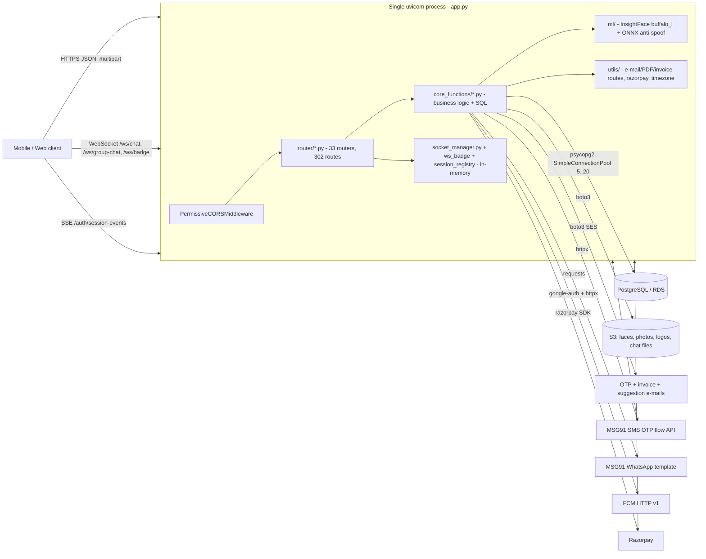

# Backend overall context (architecture, runtime, deployment, security, performance)

> **Update 2026-11-03:** this document describes the legacy backend as it was analysed. Face matching has since moved from the local InsightFace library to **AWS Rekognition** (`ml/face_service.py`, `ml/rekognition_face.py`; see `domains/face_recognition_punch.md` section 9). Mentions of InsightFace / `buffalo_l` / cosine thresholds below describe the legacy design and no longer apply.

Verified against the source in `C:\POC\pa_backend\Clockyn` on 2026-10-19 (read-only). This is the entry point of `project_complete_context/`; domain detail lives in `domains/*.md`, the data model in `database/schema.md`, the route list in `api/endpoint_catalog.md`. Items I could not prove statically are marked `(UNVERIFIED: why)`. The previous product/vendor names are referred to as "the legacy product name"; their locations are in `rename_inventory.md`. No secret values are reproduced; "a secret exists at file:line" only.

## 1. What this system is

A single-process FastAPI monolith (Python 3.11 image) for a multi-tenant workforce-management SaaS: face-based attendance with geofencing, leave/permission/shift/device requests, payroll structures and wages, incentives, expenses, CRM leads, announcements and chat, push notifications, subscription billing (Razorpay) with GST invoices, and an internal operator console. Clients: the mobile/web app (Expo; the new Clockyn app is in `C:\POC\pa_frontend\Clockyn`) over HTTPS + WebSocket + one SSE stream.

### 1.1 Repository facts

| Fact | Detail |
|---|---|
| Git root | `C:\POC\pa_backend` (remote repo name carries the legacy short name; 25 commits, 3 authors, 2026-06-25 to 2026-09-05). `C:\POC\pa_backend\Clockyn` is an **untracked, byte-identical copy** of the repo root (`git status`: `?? Clockyn/`); it is the tree being documented and will become the Clockyn backend. |
| Tracked files | 120 (the app, 24 face-embedding `.npy` files, an ONNX model, the DDL dump, the audit workbook, `Shift Issue/*`). |
| Source size | 20.4 k lines of Python: `core_functions` 14.3 k (35 files), `router` 3.9 k (32), `utils` 1.4 k (3), `ml` 0.7 k (3), `services` 0.1 k (2). Largest: `home_functions.py` 1369, `utils/email.py` 1201, `auth_function.py` 1111, `gen_dashboard_functions.py` 951. |
| Dead/duplicate code | root `chat.py` (cannot import: references `app.core.socket_manager`, undefined `MessageCreate/get_db/get_current_user`; never mounted, `app.py:3`); `router/daily_hourly.py` is a holiday-router copy (the wages router was overwritten in commit `36a555b`, 2026-09-05; the original is recoverable with `git show 36a555b^:router/daily_hourly.py`); `router/report.py` holds a third holiday copy; `services/meta_events.py` has no caller; `known_faces/` local folder is read by nothing (S3 prefix only, `ml/s3.py:16`); `ml/antispoof.py::check_liveness` unused; `ml/face.py::verify_face_global/load_all_embeddings` unused; `utils/db_function.py` listed in README does not exist. |
| Static assets | `static/` holds 3 images used only for invoices: the vendor logo PNG (invoice PDF header, `utils/email.py:172-199`; text fallback "GS" if missing), an unused WEBP copy of the logo, and a handwritten signature image printed as "Authorized Signature" (`utils/email.py:505-518`); the e-mail HTML references no image. `ml/models/modelrgb.onnx` (1.3 MB) is the anti-spoof model loaded at import but not used. |
| Tests | none in the repo (deleted `test_*.py` files exist in history, commit `1081288`). No CI workflow files. |

## 2. Architecture

### 2.1 Layers

| Layer | Location | Responsibility | Notes |
|---|---|---|---|
| Entry | `app.py` | `FastAPI(title, version)`, one custom CORS middleware, 33 `include_router` calls (`app.py:38-70`), `GET /` (`app.py:73-75`), `uvicorn.run(... reload=True)` only under `__main__` (`app.py:78-108`). | No lifespan/startup hooks, no custom exception handlers, no request-logging or auth middleware, no `OPTIONS`-independent CORS (see 2.4). |
| Routers | `router/*.py`, `utils/email.py` (invoice router) | Thin: declare path, bind params/body models, call a `core_functions` function, sometimes a plan gate. Some routers contain SQL and logic (`auth.py` operator routes, `home.py:175-212`, `salary.py:30-100`, `chat.py` file upload, `report.py` PDF merging). | 285 of 302 handlers are `async def` yet call blocking I/O (see section 9). Prefix and mount order matter; three routers share `/api/holidays` (catalogue 2.1). |
| Core | `core_functions/*.py` | All business rules and SQL, hand-written `cursor.execute`. Pydantic request models live here. | Models are imported by routers; many files mix 4xx rules with `except Exception -> 500 str(e)`. |
| Integrations/helpers | `utils/razorpay.py`, `utils/timezone.py`, `utils/email.py` (SES + PDF + invoice API, 1201 lines), `core_functions/whatsapp_service.py`, `services/meta_events.py` (dead), `ml/s3.py`, `ml/face.py` | | `utils/email.py` is both an integration and a router (`/invoice/*`, mounted `app.py:63`). |
| Real-time | `socket_manager.py`, `router/ws_badge.py`, `core_functions/session_registry.py` | Process-local dictionaries of connections/queues. | Not shared across instances. |
| Data | PostgreSQL | see `database/schema.md` | 62 tables in the DDL dump, 4 FKs. |

### 2.2 Request flow (typical)

1. Client calls an endpoint with ids in path/query/body (no token). CORS middleware answers `OPTIONS` itself (204) and decorates every other response (`app.py:19-32`).
2. FastAPI resolves the first matching route in mount order (`app.py:38-70`); validation errors become `422 {"detail": [...]}`.
3. Handler (usually `async def`) calls a `core_functions` coroutine; optional plan gate `check_plan_feature(org_id, feature, is_admin)` (`core_functions/gen_plans_functions.py:174`) first.
4. The function does `conn = get_db_connection()` (pool checkout + `SET search_path` + `commit`, `core_functions/db_function.py:52-66`), runs raw SQL with `RealDictCursor`, commits, and returns the connection in `finally` via `return_connection`.
5. Side effects (push, e-mail, WebSocket, S3 uploads) are scheduled with `asyncio.ensure_future/create_task` or run in an executor/thread; failures are logged and swallowed.
6. Errors: business errors raise `HTTPException(4xx)`; but ~207 handlers wrap everything in `except Exception as e: raise HTTPException(500, detail=str(e))` so inner 4xx become 500 and exception text leaks (`backend_changes.md` P2-1).

### 2.3 Auth model (there is no token)

| Mechanism | Where | Strength |
|---|---|---|
| Identity = ids supplied by the client (`user_id`, `org_id`, `staff_id`, `sender_id`, `created_by`, `action_by`, `role_id`, `requested_by_role_id`) | every router | none: ids are accepted as given; role/permission checks (`ROLE`, `PERM`, `MEMBER` in the catalogue) look up the role **of the id the client typed**. |
| Login = mobile number lookup (`POST /auth/login`, `/auth/employee-login`) | `core_functions/auth_function.py:952-1111` | returns `user_id`, `org_id`, `role_id`, `email`, plan/trial data for any registered number; **no OTP is required by these endpoints** (OTP is a separate pair of calls whose result the server never ties to a session). |
| OTP (`/auth/generate-otp`, `/auth/validate-otp`) | `auth_function.py:508-770` | 6-digit `random.randint`, 5-minute expiry, 5 attempts, stored in plaintext; returns/stores a `device_token` (uuid4) on `users.device_token` with a 90-day expiry column; 4 hard-coded bypass numbers (`auth_function.py:28-33,517,645`). |
| Device token | `POST /auth/verify-device-token` (app start), `GET /requests/check-session/{user_id}?device_token`, SSE `GET /auth/session-events/{user_id}?device_token` | the only server-verified credential; mismatch auto-creates a device-change request (`auth_function.py:878-893`). Not checked on any business endpoint. |
| Single-device policy / force logout | new login overwrites `users.device_token`; `force_logout_user` pushes `force_logout` to the old device's SSE queue (`session_registry.py:15-20`, `auth_function.py:745-747`) | best effort, in-memory. |
| Operator (platform admin) | `POST /auth/admin-login` (+ `/verify-otp`) then header `x-admin-id` = operator **phone number** for `/auth/gen-admin-users*`, `/auth/check-mobile`, `/auth/check-email` (`router/auth.py:148-184`) | header is a lookup key, not a secret; `/gen-dashboard/*` has no check at all. |
| Razorpay | payment signature (HMAC SHA256, key secret from DB) in `/payments/verify` (`utils/razorpay.py:32-38`); webhook HMAC with env secret (`gen_webhook_functions.py:13-24`) | verify path sound; webhook path flawed (section 8, risk 6). |

CORS: `Access-Control-Allow-Origin: *`, methods `GET,POST,PUT,DELETE,OPTIONS,PATCH`, headers `Content-Type, x-admin-id, x-role-id, Authorization` (`app.py:19-32`). Because there are no cookies or bearer tokens, the wildcard adds little beyond the missing authentication, but it must be restricted once tokens exist. `x-role-id` is allowed but no longer read by any route.

### 2.4 DB access pattern

| Aspect | Detail | Evidence |
|---|---|---|
| Driver | `psycopg2-binary`, raw SQL, `RealDictCursor`, parameterised `%s` placeholders; dynamic SQL fragments exist but come from code-controlled whitelists (`auth_function.py:22-26` OTP table map; `incentive_functions.py:16-45` query variants; `company_functions.py`, `emp_pers_detail_functions.py:134,189,195` column lists built from fixed keys). I found **no confirmed SQL injection**; `DB_SCHEMA` is regex-validated (`db_function.py:18-23`). | |
| Pool | `psycopg2.pool.SimpleConnectionPool(5, 20)` created lazily on the first request (`db_function.py:40-50`). `SimpleConnectionPool` is documented as not thread-safe, yet the app also touches the DB from executor threads (FCM/push helpers) and FastAPI's threadpool for the 17 sync routes. | `db_function.py:46`; `router/chat.py:66-96` (async helpers using the sync pool) |
| Search path | `options=-c search_path=<DB_SCHEMA>` at connect **and** `SET search_path` + `commit` on every checkout (2 extra round trips per request). | `db_function.py:37,59-62` |
| Transactions | manual; each function commits explicitly; `return_connection` returns the connection without rollback (psycopg2's pool rolls back non-idle connections on `putconn`). Multi-step flows sometimes commit in the middle (subscription then invoice, `gen_payment_functions.py:117,161`). | |
| Timeouts | none (no `statement_timeout`, no `connect_timeout`). | |
| IDs | uuid4 strings; some `MAX()+1` integer ids (`schema.md`). | |
| Runtime DDL | `leads_functions.py:274,288-289,324,366`. | |
| Time zone | store UTC; display IST in some endpoints; business dates (`attendance_date`, trial, holiday) use UTC/server date. | `utils/timezone.py`, `schema.md` section 1.1 |

### 2.5 Background work and state

| Work | How | Failure behaviour |
|---|---|---|
| Push notifications (FCM) | `asyncio.ensure_future(send_push_notification(...))` / `asyncio.create_task(_send_fcm_push(...))` (`announcement_functions.py:108`, `chat_functions.py:651,725`, `face_attendance_functions.py:259,355`, `requests_functions.py:21,95`, `router/chat.py:194,282,407,474`). The returned task is not stored. | exceptions logged at WARNING and dropped; tasks may be garbage-collected before completion (Python docs warn about unreferenced tasks). |
| Punch photos to S3 | background coroutine + `run_in_executor` after the DB commit (`face_attendance_functions.py:236-251,330-345`) | URL written back later; response may carry no photo URL. |
| Invoice e-mail | daemon `threading.Thread` (`utils/email.py:758-763`) | lost on restart; no retry/queue. |
| Suggestion e-mail | daemon thread (`suggest_feature_functions.py:110`). | same |
| OTP e-mail | `asyncio.create_task` + executor (`auth_function.py:612,323`). | same |
| WebSocket chat | `ConnectionManager.active_connections: Dict[str, List[WebSocket]]` (`socket_manager.py:8-14`); fan-out in `broadcast_*`. | per process only |
| Badge WebSocket | `_connections: Dict[str, WebSocket]` one socket per user (`router/ws_badge.py:8`); `notify_org_badge_update` (broadcasts to **all** connected users, ignoring `org_id`) is defined but unused. | per process only |
| Force-logout SSE | `_sessions: Dict[str, Queue]` one queue per user (`session_registry.py:5`) | per process only |
| Face embedding cache | `EMBEDDING_CACHE` dict, per-user lazy load from S3, never expired; evicted only on re-registration/delete in the same process (`face_recognition.py:16-22`, `face_attendance_functions.py:100,126`) | stale across instances; unbounded growth |
| Scheduled jobs | **none** (no scheduler, cron, Celery): subscription expiry is derived from dates; expired OTP rows, `staff_location_logs`, webhook rows are never purged except the unauthenticated `DELETE /staff-location/cleanup`. | |

### 2.6 Startup cost and memory

| Step | Cost | Evidence |
|---|---|---|
| `from router import ...` imports `face_attendance` -> `core_functions.face_recognition` -> `ml.face` | At **import time** loads InsightFace `buffalo_l` (detector + recognition + landmarks + gender/age models) with `det_size=(320,320)` and an ONNX anti-spoof session (1.3 MB). The model pack is downloaded to the InsightFace home directory on first use if absent (network egress, tens of MB; the Dockerfile does not pre-download it) `(UNVERIFIED: exact download size and cache path at runtime)`. | `ml/face.py:44-64`; `Dockerfile` |
| `ml/s3.py` | creates the global boto3 S3 client at import (`ml/s3.py:18-23`). | |
| DB pool | not at startup: first request pays for 5 connections + schema checks. | `db_function.py:40-50` |
| Heavy libraries | numpy, opencv-headless, onnxruntime, insightface, scikit-image (unused), reportlab, openpyxl, pypdf, boto3: several seconds of import and ~1-2 GB RSS expected `(UNVERIFIED: not measured)`. | `requirements.txt` |
| Log suppression side effect | importing `ml.face` sets the **root** logger level to ERROR (`ml/face.py:28`), silencing all INFO/WARNING application logs (section 7). | |

Expect a slow cold start and no readiness signal (the only health-like route is `GET /` which does not touch the DB).

## 3. Integrations

| Integration | Used for | Code | Config (names only) | Failure mode / notes |
|---|---|---|---|---|
| AWS S3 | face embeddings (`known_faces/{user_id}/{uuid}.npy`, float32 bytes, max 4), org logo (`org_logo/{org_id}.png`), profile photo (`employee_profile/{user_id}.jpg|png`), punch photos (`empolyee-punch-photos/{org}/{user}/{attendance_id}_{action}.jpg`, intentional typo in the key prefix `ml/s3.py:187`), chat files (`documents/{uuid}_{filename}`), support photos (`client_support/{uuid}_{filename}`); private bucket, presigned GET URLs valid 7 days (`ExpiresIn=604800`, `ml/s3.py:130,145,166,179,206,247,300`) | `ml/s3.py`, `emp_expenses_functions.py:8` (reuses client), `gen_dashboard_functions.py:593,773,859` | `AWS_ACCESS_KEY_ID`, `AWS_SECRET_ACCESS_KEY`, `AWS_S3_REGION`, `S3_BUCKET_NAME` | static keys passed explicitly (`None` falls back to the default credential chain/instance role); head_object per photo lookup. |
| AWS SES | OTP e-mail, invoice e-mail with PDF attachment (`send_raw_email`), feature-suggestion notification | `auth_function.py:308-330`, `utils/email.py:584-756`, `suggest_feature_functions.py:12-60` | `EMAIL_USER` (sender), `AWS_SES_REGION` (default `ap-south-1`) | uses the default boto3 credential chain (not the `AWS_*` keys above); HTML bodies interpolate unescaped user data. |
| MSG91 SMS | OTP via flow API `control.msg91.com/api/v5/flow` with `template_id` and `numeric` variable | `auth_function.py:908-950` | `MSG91_AUTH_KEY`, `MSG91_TEMPLATE_ID` | synchronous `httpx.Client` (10 s timeout) inside async handlers; failure only warns, OTP row stays; the SMS text/template lives at the provider (DLT). |
| MSG91 WhatsApp | staff invitation template (`body_var_1..3` = name, org, store link) | `core_functions/whatsapp_service.py` | `MSG91_WHATSAPP_AUTH_KEY`, `MSG91_WHATSAPP_NUMBER`, `MSG91_WHATSAPP_TEMPLATE` (default = a template named with the legacy product), `APP_PLAY_STORE_LINK` (default = legacy store link) | sync `requests.post` (10 s); full payload incl. phone number logged at INFO; webhook receiver stores raw events (`gen_webhook_functions.py:90-143`). |
| Razorpay | orders (`payment_capture=1`, amount x100), signature verification, webhook | `utils/razorpay.py`, `gen_orders_functions.py`, `gen_payment_functions.py`, `gen_webhook_functions.py` | key id/secret in table `gen_razorpay_key` (cached 5 min); `RAZORPAY_WEBHOOK_SECRET` | secret in DB plaintext (a secret exists at `gen_razorpay_key.key_secret`); `mode` column unused. |
| Firebase FCM HTTP v1 | push for punch events, requests, chat, announcements | `auth_function.py:49-100,150-210`, `router/chat.py:28-72` | `FCM_PROJECT_ID`, `FCM_PRIVATE_KEY_ID`, `FCM_PRIVATE_KEY` (`\n` unescaped at `auth_function.py:79`), `FCM_CLIENT_EMAIL`, `FCM_CLIENT_ID`, `FCM_SERVICE_ACCOUNT_PATH` (file fallback, default `firebase-service-account.json`) | token cached 55 min in process; with the file fallback `FCM_PROJECT_ID` must still be set because the cached project id is taken from the env (`auth_function.py:109`); Android channel id `attendance_notifications` (`auth_function.py:182`, `router/chat.py:53`); one Firebase project only. |
| Meta Conversions API | intended: events `CompleteRegistration`, `Subscribe`, `AttendanceMarked`, `LeaveRequest` | `services/meta_events.py` | `META_ACCESS_TOKEN`, `META_PIXEL_ID` | **No caller anywhere** (dead code); the file's docstring embeds a Meta app id (an id exists at `services/meta_events.py:7`). Attribution endpoints only write DB rows (`/attribution/meta`). |
| ML | InsightFace `buffalo_l` CPU embeddings (512-d), cosine similarity with the mean of stored embeddings, threshold 0.62 (`ml/face.py:54`, `face_recognition.py:35`); ONNX anti-spoof loaded but its call is commented out (`ml/face.py:167-175`) | | none | CPU-bound work executes in the event loop. |
| Expo push | claimed in README | **no code path found** (only a comment mentioning "Expo token", `auth_function.py:841`) | | README is inaccurate. |

## 4. Runtime configuration (env var names)

Loaded with `python-dotenv` (`load_dotenv()` in `db_function.py:11`, `whatsapp_service.py`, `ml/s3.py:8`, `migrate.py:10`); the container receives them as real env vars (README: `docker run --env-file .env`). `.env` is git-ignored (`.gitignore:138`) and docker-ignored (`.dockerignore`), but `.env.*` variants are **not** ignored.

| Variable | Required? | Read at | Purpose / default |
|---|---|---|---|
| `DB_SCHEMA` | **Yes** (raises at first DB use) | `db_function.py:27`, `gen_dashboard_functions.py:9`, `router/auth.py:60,101` | search_path; regex `^[A-Za-z_][A-Za-z0-9_]*$` |
| `DB_HOST`, `DB_NAME`, `DB_USER`, `DB_PASSWORD` | Yes | `db_function.py:32-35` | PostgreSQL connection |
| `DB_PORT` | no | `db_function.py:36` | default 5432 |
| `S3_BUCKET_NAME`, `AWS_S3_REGION` | Yes for any file feature | `ml/s3.py:12,14` | bucket and region (`None` at import does not fail; first S3 call fails) |
| `AWS_ACCESS_KEY_ID`, `AWS_SECRET_ACCESS_KEY` | Optional if an instance role exists | `ml/s3.py:10-11` | S3 static credentials |
| `EMAIL_USER` | Yes for OTP e-mail/invoices/suggestions | `auth_function.py:44`, `utils/email.py:586`, `suggest_feature_functions.py:28` | SES verified sender |
| `AWS_SES_REGION` | no | same | default `ap-south-1` |
| `MSG91_AUTH_KEY`, `MSG91_TEMPLATE_ID` | Yes for SMS OTP | `auth_function.py:38-39` | empty = SMS skipped with a warning |
| `MSG91_WHATSAPP_AUTH_KEY`, `MSG91_WHATSAPP_NUMBER` | for invitations | `whatsapp_service.py:28,68-69` | empty = "WA FALLBACK" log, returns False |
| `MSG91_WHATSAPP_TEMPLATE`, `APP_PLAY_STORE_LINK` | no | `whatsapp_service.py:29-33` | defaults reference the legacy product |
| `FCM_PROJECT_ID`, `FCM_PRIVATE_KEY`, `FCM_CLIENT_EMAIL`, `FCM_PRIVATE_KEY_ID`, `FCM_CLIENT_ID` | for push | `auth_function.py:49-53` | service account in env; missing = push silently skipped |
| `FCM_SERVICE_ACCOUNT_PATH` | no | `auth_function.py:55` | local-dev file fallback |
| `RAZORPAY_WEBHOOK_SECRET` | for the webhook | `gen_webhook_functions.py:10` | default `""` (signature check then uses an empty key; no startup validation) |
| `META_ACCESS_TOKEN`, `META_PIXEL_ID` | no (dead) | `services/meta_events.py:23-24` | |
| (set by code) `WATCHFILES_IGNORE_PATHS`, `TF_CPP_MIN_LOG_LEVEL`, `GLOG_minloglevel` | - | `app.py:94`, `ml/face.py:29-30` | |

README lists `MSG91_SENDER_ID`, `META_APP_ID`, `META_CLIENT_TOKEN` (not read by code) and omits `RAZORPAY_WEBHOOK_SECRET`, `APP_PLAY_STORE_LINK`, `FCM_SERVICE_ACCOUNT_PATH`. Razorpay API key/secret are **not** env vars (DB table).

### 4.1 README claims versus code

| README claim | Reality |
|---|---|
| Push = Expo Push API + FCM | FCM only |
| PDF = ReportLab + WeasyPrint | WeasyPrint (and xhtml2pdf, scikit-image) never imported |
| Meta CAPI integrated | module exists, never called |
| Face similarity threshold 0.56 | 0.62 (`ml/face.py:54`, `core_functions/face_recognition.py:35`) |
| Embedding cache "loaded once from S3" | per-user lazy cache; the "load all" function is unused |
| Log level INFO in production | root logger forced to ERROR (section 7) |
| Folder tree: `utils/db_function.py (alias)`, `chat_groups`, `/salary/*`, `/daily-hourly/*`, `/location/*`, `/dashboard/*`, `/profile/*`, `/staff/*`, `/report/*`, `/advance/*`, `/holiday/*` | not as written: real prefixes are `/api/salary`, (wages router missing), `/staff-location`, `/gen-dashboard`, `/profile-photo`, `/addstaff`, `/api/reports`, `/api/advance`, `/api/holidays`; the group table is `group`; README omits `/api/incentive`, `/api/leads`, `/api/announcements`, `/support`, `/version`, `/attribution` |
| `known_faces/` is a local `.npy` cache | no code reads it |
| Multiple sessions per day (max 2) | true in code; contradicted by the DDL unique index (schema.md risk 2) |

## 5. Deployment

### 5.1 Container

| Item | Detail |
|---|---|
| Base | `python:3.11-slim`, `PYTHONDONTWRITEBYTECODE=1`, `PYTHONUNBUFFERED=1` (`Dockerfile:1-5`). Local `.pyc` files are cpython-313, so dev and image Python versions differ. |
| System packages | `build-essential gcc g++ cmake git libgl1 libglib2.0-0 libsm6 libxext6 libxrender1 fonts-dejavu-core pkg-config libcairo2-dev libpango1.0-dev libffi-dev shared-mime-info` (`Dockerfile:10-27`). Needed for: insightface source build (compilers, cmake), OpenCV runtime libs, DejaVu font for the rupee glyph in invoices (`utils/email.py:37-47`). **cairo/pango/shared-mime-info exist only for WeasyPrint, which is unused** (can be dropped together with `weasyprint`, `xhtml2pdf`, `scikit-image`). |
| Build | `pip install -r requirements.txt` after copying only the requirements (layer cache OK); single stage, so compilers stay in the final image; runs as **root**. |
| Context hygiene | `.dockerignore` excludes `.venv`, `__pycache__`, `.git`, `.vscode`, `.env` only. `COPY . .` therefore bakes in `known_faces/` (24 real biometric embedding files of 6 users), the audit workbook, the DDL dump, `README.md`, `fix.sql`, `project_complete_context/`, and, in the parent repo, `Shift Issue/`. |
| Run | `CMD uvicorn app:app --host 0.0.0.0 --port 8080` : one worker, no `--proxy-headers`, no `--timeout-keep-alive`, no `HEALTHCHECK`. |
| Port | 8080 (`EXPOSE 8080`, `app.py:100`). |

### 5.2 `requirements.txt` map

| Package | Used for | Where |
|---|---|---|
| fastapi 0.128.6, uvicorn[standard] 0.24.0, pydantic 2.12.5, python-multipart | web framework, ASGI server (old pin), models, form/file uploads | all routers |
| python-dotenv | `.env` loading | `db_function.py`, `ml/s3.py`, `whatsapp_service.py`, `migrate.py` |
| psycopg2-binary 2.9.11 | PostgreSQL driver (binary wheel; upstream recommends building from source for production) | `db_function.py` |
| httpx 0.28.1 / requests 2.32.5 | FCM, MSG91 SMS, Meta / WhatsApp, google-auth transport | `auth_function.py`, `router/chat.py`, `whatsapp_service.py` |
| boto3 1.34.0 | S3, SES (old pin) | `ml/s3.py`, `utils/email.py` |
| pytz, python-dateutil | tz objects, `relativedelta` (trial/subscription end) | `db_function.py`, `auth_function.py:450`, `gen_payment_functions.py` |
| razorpay 2.0.1 | order creation | `utils/razorpay.py` |
| numpy 2.4.2, opencv-python-headless, onnxruntime 1.20.0, insightface 0.7.3, pillow | face detection/embedding, anti-spoof session, image decode/resize | `ml/face.py` (insightface 0.7.3 with numpy 2.x compatibility `(UNVERIFIED)`) |
| scikit-image 0.26.0 | **not imported anywhere** | - |
| reportlab 4.4.10 | invoice PDF, attendance/salary PDFs | `utils/email.py`, `report_functions.py` |
| pypdf 6.9.2 | merge PDFs for all-staff reports | `router/report.py:11,96,175` |
| weasyprint 68.1, xhtml2pdf 0.2.17 | **not imported anywhere** | - |
| openpyxl 3.1.5 | bulk invoice Excel summary | `utils/email.py:16-17` |
| google-auth 2.29.0 (+ cachetools, rsa, pyasn1, pyasn1-modules pinned as transitive deps) | FCM OAuth token | `auth_function.py:74-101` |
| packaging (unpinned) | app-version comparison | `router/version.py:4` |
| (not listed but imported) | `sqlalchemy` only in dead root `chat.py`; `smtplib` imported, unused (`auth_function.py:12`) | |

### 5.3 App Runner assumptions (nothing in the repo states the target; these follow from the code and README)

| Assumption | Basis | Consequence / check |
|---|---|---|
| Container from ECR on AWS App Runner, port 8080, env vars from App Runner secrets/SSM | README ("SSM-compatible" FCM keys), `EXPOSE 8080`, no compose/IaC files | Provide all section-4 variables; prefer an instance role for S3/SES (code already falls back to the credential chain). |
| RDS in a VPC | README ("PostgreSQL (AWS RDS)") | App Runner needs a VPC connector; keep outbound internet for MSG91, Razorpay, FCM, Meta and the InsightFace model download (or bake the model into the image). |
| Health check on `/` | `GET /` returns static JSON (`app.py:73-75`) | Does not prove DB/S3/ML readiness; add `/healthz` (DB ping) and `/readyz`. |
| Autoscaling by concurrency | default App Runner scaling | Handlers block the event loop and the process is single-threaded for inference, so high configured concurrency just queues requests; also **in-memory WebSocket/SSE/cache state is per instance**, so more than one instance breaks chat/badge fan-out and force-logout. Use one instance, or move fan-out to Redis/SNS and the cache to S3-versioned reads. |
| WebSockets and SSE through the service | app uses `/ws/*` and SSE | confirm App Runner's WebSocket support and request-duration limits `(UNVERIFIED: platform behaviour not checked)`; the app sends no keep-alive for chat sockets (only SSE heartbeat every 30 s). |
| Memory/CPU | InsightFace + ONNX CPU | choose at least 2 vCPU / 4 GB `(UNVERIFIED sizing)`. |
| No CI/CD | no workflow, buildspec, compose or IaC files in the tree or in git history | pipeline to build/push image and run migrations is not defined (see `database/migrations_and_changes.md`). |

### 5.4 Schema/environment model

`migrations/README.md` describes a dev schema and a `public` schema in a QA database; the DDL dump is qualified with a separate production schema (legacy-named). Treat the schema name as environment configuration (`DB_SCHEMA`) and plan the rename together with the data (see `rename_inventory.md`).

## 6. `.gitignore`, repo hygiene and history

| Check | Result |
|---|---|
| `.env`, `.envrc`, `.venv`, `__pycache__`, `.vscode`, `firebase-service-account.json` ignored | yes (`.gitignore:138-146,217`) |
| `.env.local`, `.env.production`, `*.pem`, `*.key`, `known_faces/`, `*.xlsx`, `*.csv` ignored | **no** |
| Secrets in history | none found among added file names (`.env`, `.json`, `.pem`, `firebase`, `key`, `credential`); not content-scanned beyond that `(UNVERIFIED)`. A Meta app id is in source (`services/meta_events.py:7`), an RDS host in `migrations/README.md:10,15`. |
| Biometrics in git | 24 `.npy` embeddings for 6 user ids tracked (`known_faces/`), also baked into images |
| Customer data in git | `Shift Issue/shift_202609051215.csv` (75 shifts with org ids), `PA_Backend_Audit_Report.xlsx` |
| History | 25 commits: initial push 2026-06-25 (134 files), cleanup 2026-06-26 (-3983 lines, deleted tests/migrations/design DDL), DDL added 2026-07-25, last change 2026-09-05. Wages router overwritten in `36a555b`. |

## 7. Logging and observability

| Aspect | Reality | Evidence |
|---|---|---|
| Configuration | `logging.basicConfig` only inside `if __name__ == "__main__"` (`app.py:78,84-88`); under the Docker `uvicorn app:app` command it never runs. `ml/face.py:28` additionally sets the root logger to ERROR at import. | consequence: `logger.info/warning` from modules (`[FCM]`, `[Notify]`, `[PushToken]`, payment, webhook) are not emitted in production; only `logger.error/exception`, uvicorn's own access/error loggers and `print()` output (45 `print` calls, `PYTHONUNBUFFERED=1`) reach stdout/stderr `(UNVERIFIED at runtime; follows from stdlib logging rules)`. README ("INFO in production") is wrong. |
| Format | free text with ad-hoc prefixes; no request id, user id or org id context; no JSON | |
| PII/secrets in logs | personal-details payload printed (Aadhaar/PAN/bank) `emp_pers_detail_functions.py:182-184`; operator OTP printed `router/auth.py:84`; device tokens logged `auth_function.py:816-818`; WhatsApp payload with phone numbers `whatsapp_service.py:93`; webhook payloads logged `gen_webhook_functions.py:111`; push-token debug endpoint `router/auth.py:386-406` | audit says several fixed; these remain |
| Errors | 253 `status_code=500` sites, 207 return `str(e)` to the client; 23 `import traceback` statements (used for `print_exc`) | |
| Metrics/tracing/alerts | none; no health/readiness endpoint with dependency checks; no error reporter (Sentry etc.); README: "no external monitoring agent" | |
| Audit trail | `activity_tracking` insert is broken (schema drift, `schema.md`); no access logs of PII reads | |

## 8. Security posture

### 8.1 Top 15 risks (ranked)

| # | Sev | Risk | Evidence | Fix direction |
|---|---|---|---|---|
| 1 | Critical | **No authentication on the API**: identity is client-typed ids. 185 SELF + 73 NONE of the 293 live route decorators (catalogue guard counts); role/permission checks consume the client-supplied id, so sending an admin's id passes them. Cross-tenant read/write/delete (IDOR) everywhere. | `api/endpoint_catalog.md` sections 1, 3; `permission_checker.py:7-44` | Issue signed tokens at OTP verification (session table, `database/migrations_and_changes.md` M5), add a FastAPI dependency that derives `user_id/org_id/role_id`, enforce tenant and role in every query. |
| 2 | Critical | **Phone-number-only identity oracle and bypass numbers**: `/auth/login` and `/auth/employee-login` return `user_id/org_id/role_id` for any mobile number without OTP, and 4 hard-coded numbers (2 admin, 2 employee) accept a fixed OTP (audit item 1 says Fixed; still present). Together with risk 1 this is a one-request account takeover. | `auth_function.py:952-1111`, `:28-33,517,645` | Make login endpoints require a validated OTP/session; delete the bypass or gate it by environment. |
| 3 | Critical | **Operator console and catalogue admin are open**: all 21 `/gen-dashboard/*` routes (list all tenants/users/payments, activate/deactivate/**delete organisations**), plan and coupon create/update/delete, operator CRUD guarded only by an `x-admin-id` phone header. | `router/gen_dashboard.py`, `router/gen_plans.py:62-90`, `router/auth.py:148-246` | Separate operator auth (token + role), IP allow-list/VPN, remove from the public API. |
| 4 | Critical | **Biometric tampering and fraud**: `POST /face/register` is unauthenticated and replaces any user's stored embeddings; `force_accept=true` skips matching; anti-spoof disabled; mean-embedding threshold 0.62. | `router/face_attendance.py:29-51`, `ml/s3.py:30-69`, `face_attendance_functions.py:132-139`, `ml/face.py:167-175` | Authenticate; require admin approval to re-enrol; remove/limit `force_accept`; enable liveness. |
| 5 | High | **Payments**: client supplies the amount (`gen_orders_functions.py:12-18`); order creation checks only that the user exists; webhook HMAC is computed over re-serialised JSON, not the raw body, uses an env secret that defaults to empty, and crashes on a missing header; webhook `gen_payments` insert omits NOT NULL `org_id`; MSG91 webhook has no signature; Razorpay secret stored in plaintext in DB. | `gen_webhook_functions.py:10-55,90-143`, `router/gen_webhook.py`, `schema.md` (`gen_razorpay_key`) | Server-side pricing; verify HMAC on `request.body()`; fail fast without secret; fix insert; move secret to a manager. |
| 6 | High | **PII and biometric exposure**: staff bank/Aadhaar/PAN/DOB by id (`/addstaff/{id}`, `/home/staff-profile`, `/employee/personal-details/{id}`), `/auth/user-mobile/{id}`, `/auth/employee-profile/{id}`, invoices (`/invoice/*` keyed by guessable ids, bulk zip of all tenants), report PDFs; face/punch images behind 7-day presigned URLs stored in the DB; plaintext PII at rest. | catalogue guard SELF/NONE rows; `ml/s3.py:130-300`; `schema.md` | Authorise per route, minimise fields, short-lived URLs minted per request, encrypt columns. |
| 7 | High | **Unauthenticated WebSockets/SSE**: connect as any `user_id` and receive that user's chat/badge events or send messages in their name. | `router/chat.py:138-156`, `router/ws_badge.py:37-52` | Token in the first message/query, verify before `accept()`. |
| 8 | High | **Destructive endpoints open**: delete account/company (cascades through ~25 tables), staff permanent delete (role from a query claim), location cleanup for all tenants, delete announcements/leads/templates by bare id. | `company_functions.py:408-470`, `add_staff_function.py:696-705`, `router/staff_location.py:40-44` | Authz + soft delete + confirmation/audit. |
| 9 | High | **Multi-tenancy not enforced**: tables carry only string `org_id`; many queries filter by a single id (shift, branch, template, lead, incentive ids are bare); `branch_id` not unique across orgs; `edit_attendance` has no org filter. | `schema.md`; `attendance_functions.py:277-300`; `branch_functions.py:332` | Always join on `(org_id, id)`; add FKs/unique keys. |
| 10 | Medium | **Secrets and config**: static AWS keys via env, FCM private key in env, Razorpay secret in DB, README says `.env` "contains live credentials", only `.env` is ignored; image bakes in `known_faces/`. | section 4, 5.1, 6 | Secrets Manager/instance role; extend `.gitignore`/`.dockerignore`; purge biometrics from git history. |
| 11 | Medium | **OTP/session weaknesses**: `random` not `secrets`, OTP stored plaintext, no per-number/IP send limit, device token is a plaintext uuid valid 90 days, enforced only at app start, never rotated, no logout/revocation endpoint. | `auth_function.py:578,729,830` | `secrets.randbelow`, hash OTPs, throttle table (`migrations_and_changes.md` M14), session table. |
| 12 | Medium | **Information disclosure**: 207 handlers return `str(e)`; debug endpoint `/auth/push-token-status/{id}` returns a token prefix; logs contain PII/OTP/tokens (section 7). | `router/auth.py:386-406` | Generic 500 + server-side logging; delete the debug route. |
| 13 | Medium | **Input hardening**: no upload size/type limits (profile, logo, chat, support, odometer photos; `await file.read()` into memory; PIL decode of arbitrary images), S3 key built from client filename, HTML e-mails interpolate user data unescaped, no rate limits on any endpoint. | `router/chat.py:360-440`, `ml/s3.py:237`, `utils/email.py:559-700`, `suggest_feature_functions.py:35-45` | Size caps, content sniffing, filename sanitising, `html.escape`, WAF/rate limiting. |
| 14 | Medium | **CORS `*`** with all headers; harmless today without cookies but wrong once tokens exist. | `app.py:19-32` | allow-list. |
| 15 | Medium | **Business-logic abuse**: staff limit not enforced during trial; free trial per org one-time but re-registration with another number creates new orgs; advance amounts unvalidated; `x-role-id`-style claims (`requested_by_role_id`, `role_id`, `action_by`) are trusted; coupon codes enumerable. | `add_staff_function.py:292-312`, `advance_functions.py:36-50`, `requests_functions.py:429-499` | Server-side rules once identity exists. |

SQL injection: not a ranked risk (parameterised; dynamic fragments are code-controlled). Cross-checks of the audit workbook are below.

### 8.2 The audit workbook (`PA_Backend_Audit_Report.xlsx`, 4 sheets, undated, statuses as recorded vs. code today)

Sheet contents: Summary Dashboard (headline counts 14/22/8/2 which do not match the detail sheet), All Findings (56 findings, ids 1-56), Critical & High (42 rows), PII & Data Exposure (9 rows). Real counts in the detail sheet: **17 Critical, 25 High, 11 Medium, 3 Low = 56; status: 30 Open, 23 Fixed, 3 Partially Fixed.** Categories: Authentication, Authorization, PII/Data exposure, SQL injection, Multi-tenancy, Payment logic, Race condition, CORS, Info disclosure, Performance, Biometric security, Logic bug, Code quality, WebSocket, Chat.

Re-verification of the items I could check in the current code (the statuses in the sheet are stale in both directions):

| # | Finding (workbook status) | Current code | Verdict |
|---|---|---|---|
| 1 | Hard-coded OTP bypass (Fixed) | still present for 4 numbers: `auth_function.py:28-33,517,645` | **not fixed** |
| 2 | No OTP rate limit (Open) | attempts counted and locked at 5 (`:585-595,697-714`) | fixed for guessing; sending is still unthrottled |
| 3 | Device token never expires (Open) | `device_token_expires_at` set +90 d and checked in `verify_device_token` (`:729,830`) | partly fixed; not enforced elsewhere |
| 4 | Header-based role check (Open) | now `x-admin-id` phone lookup (`router/auth.py:168-184`) | still weak (header is the key) |
| 5 | Open enumeration endpoints (Open) | `check-mobile/check-email` now need an operator header; `gen-admin-users` too | partly fixed; breaks the app's duplicate pre-check (P3-5) |
| 6 | SSE unauthenticated (Partially) | device_token verified (`router/auth.py:418-424`) | fixed |
| 7 | OTP printed (Fixed) | removed in `auth_function.py`; **still printed** at `router/auth.py:84` | not fixed |
| 8 | SMS credentials logged (Fixed) | only last 4 digits logged (`auth_function.py:910`) | fixed |
| 9 | Order ownership on verify (Fixed) | `AND go.user_id = %s` (`gen_payment_functions.py:44`) | fixed |
| 10 | File upload endpoints unauthenticated (Open) | unchanged (`router/auth.py:330-360`, `router/profile_photo.py`) | open |
| 11 | Staff PII without authz (Partially) | `get_staff_detail` still unchecked (`add_staff_function.py:464-486`) | open |
| 12, 13 | Salary / attendance PDF without authz (Open / Partially) | `router/report.py:49-65` unchecked; manager variants check permission | open |
| 14 | 7-day presigned URLs (Open) | unchanged | open |
| 18, 19, 20 | f-string SQL identifiers (Fixed) | whitelist map and schema regex present | fixed |
| 21 | `edit_attendance` without org filter (Open) | unchanged (`attendance_functions.py:277-300`) | open |
| 22 | advance org mismatch (Fixed) | org check present (`advance_functions.py:26-33`) | fixed |
| 23 | delete_branch staff count (Fixed) | fixed in `delete_branch` (`branch_functions.py:232`), but `reassign_staff` still counts without org (`:332`) | partly |
| 24 | order creation org check (Open) | unchanged (`gen_orders_functions.py:25-28`) | open |
| 25 | payment replay (Fixed) | `status == PAID` early return (`gen_payment_functions.py:51-52`) but no row lock: concurrent verifies can both pass | mitigated, not atomic |
| 26 | webhook header alias (Fixed) | `alias='X-Razorpay-Signature'` present (`router/gen_webhook.py:9`) | fixed |
| 27 | webhook env secret (Fixed) | still `os.getenv(..., "")` with no validation (`gen_webhook_functions.py:10`); HMAC over re-serialised JSON | **not fixed** |
| 28 | webhook does not activate subscription (Open) | unchanged; also the webhook insert would fail on NOT NULL `org_id` | open |
| 29 | free trial uniqueness (Fixed) | `UNIQUE (org_id)` in DDL, `ON CONFLICT` in code | fixed |
| 30 | staff limit not enforced (Fixed) | enforced when a subscription exists (`add_staff_function.py:292-312`); trial unlimited | partly |
| 31, 32, 33 | invoice atomicity, GST rounding, float payroll (Open) | unchanged (`gen_payment_functions.py:117,124-126`; `salary_structure.py:168-169`) | open |
| 36 | punch race (Fixed) | `pg_advisory_xact_lock` (`face_attendance_functions.py:187-190`); but see the DDL unique-index conflict | fixed |
| 38 | CORS (Open) | unchanged | open |
| 39 | raw DB errors returned (Fixed) | still 207 sites | **not fixed** |
| 44 | anti-spoof disabled (Open) | unchanged | open |
| 45 | threshold (Fixed) | 0.62 | fixed |
| 51, 52 | WebSocket auth (Open) | unchanged | open |
| 56 | Razorpay client cache (Fixed) | 5-minute cache (`utils/razorpay.py:42-67`) | fixed |

Not re-verified (no code check made): 15, 16, 17, 34, 35, 37, 40-43, 46-50, 53-55.

## 9. Performance and scalability risks

| # | Risk | Evidence | Impact | Direction |
|---|---|---|---|---|
| 1 | Blocking I/O inside `async def`: 285 of 302 handlers call synchronous psycopg2/boto3/requests/reportlab directly | catalogue totals; e.g. `core_functions/gen_plans_functions.py` all `async` with sync cursors | one slow query/S3 call stalls every request of the process | make DB/S3 helpers sync and declare handlers `def` (threadpool), or use async drivers; use `run_in_threadpool` for S3/PDF. |
| 2 | CPU-bound face inference on the event loop (`encode_face` 1x per punch, 4x per registration) | `face_attendance_functions.py:90,138` | punch bursts (shift start) serialize all traffic; seconds of stall | run in a process/thread pool, limit concurrency, GPU/ONNX tuning. |
| 3 | N+1 S3 calls: `get_employee_profile_url` does up to 2 `head_object` per staff per list | `home_functions.py:371,540,612,689,762,840,1142,1213`, `router/salary.py:100`, `chat_functions.py:168,207` | dashboards of 100 staff = 100-200 sequential S3 round trips | store photo key/flag in DB, presign without head, batch. |
| 4 | DB: 2 extra round trips per checkout; no timeouts; thread-unsafe pool; lazy first-request init | `db_function.py:52-66` | latency and pool errors under load | `ThreadedConnectionPool` or pgbouncer, set `statement_timeout`, drop redundant `SET`. |
| 5 | Missing indexes on chat tables and others; unbounded lists (no pagination: `/addstaff/all-staff`, `/requests/admin/{org}` polled every 10 s by the app, history, `/invoice/bulk-download`) | `schema.md` | sequential scans, large payloads | add indexes and pagination/counts endpoints. |
| 6 | Per-process state: embedding cache, WS/SSE registries | section 2.5 | breaks with >1 instance, stale biometrics, memory growth | externalise or pin to one instance; TTL/LRU cache. |
| 7 | Cold start: models loaded at import and possibly downloaded | section 2.6 | slow deploys and restarts, no readiness gate | bake models into the image, lazy-load with readiness probe. |
| 8 | Fire-and-forget tasks/threads | section 2.5 | lost pushes/e-mails, task GC | keep task references, queue (SQS/Celery) with retry. |
| 9 | Report/PDF/Excel generation on the request thread | `report_functions.py`, `router/report.py`, `utils/email.py:1097-1190` | long requests for big orgs | generate async, store in S3, return link. |
| 10 | Synchronous SMS/WhatsApp HTTP in handlers (10 s timeouts) | `auth_function.py:940`, `whatsapp_service.py` | a slow provider blocks login | async httpx or background task. |
| 11 | Presigned URL generation per chat message row | `chat_functions.py:243-258` (audit 42) | slow history | cache or sign lazily. |

## 10. Map of `project_complete_context/`

| Path | Content | Author scope |
|---|---|---|
| `_spec/DOC_BRIEF.md` | documentation brief and per-domain template | brief |
| `overall_context.md` | this file | architecture, runtime, deployment, security, performance |
| `database/schema.md` | full data dictionary (62 tables + objects missing from the DDL), ERDs, enum meanings, integrity risks | database |
| `database/migrations_and_changes.md` | how schema changes are applied, git-history recovery, proposed Clockyn schema changes with DDL sketches | database |
| `api/endpoint_catalog.md` | all 302 mounted routes (generated by AST), guards, shadowed routes, unauthenticated list | API |
| `rename_inventory.md` | the only document that lists the legacy product/vendor names: every occurrence with file:line, kind and rename plan | rename |
| `domains/identity_auth_onboarding.md` | OTP login, registration, device token | domain |
| `domains/employee_profile_version_attribution.md` | personal details, profile photo, version check, Meta attribution | domain |
| `domains/org_structure_company_branch_dept.md` | company, branch, department, account deletion, org logo | domain |
| `domains/staff_management.md` | add/edit/delete staff, staff lists and profiles | domain |
| `domains/managers_shifts_holidays.md` | managers and permissions, shifts, holidays/off days | domain |
| `domains/attendance_and_home.md` | home dashboards, attendance reads, edit punch | domain |
| `domains/face_recognition_punch.md` | face register/punch, geofence | domain |
| `domains/staff_location.md` | live location logs | domain |
| `domains/reports_and_advance.md` | PDF reports, advances | domain |
| `domains/requests_and_approvals.md` | leave, permission, shift, device-change requests | domain |
| `domains/expenses.md` | odometer and travel/bill expenses | domain |
| `domains/crm_leads.md` | leads, categories, carry-forward | domain |
| `domains/announcements.md` | announcements | domain |
| `domains/support_and_feedback.md` | tickets, suggestions | domain |
| `domains/salary_and_payslips.md` | pay slip templates, assignment, preview | domain |
| `domains/incentives.md` | count/turnover/overtime/bonus incentives | domain |
| `domains/wages_daily_hourly.md` | wage templates (router missing) | domain |
| `domains/chat_and_groups.md` | 1:1 and group chat | domain |
| `domains/websockets_realtime.md` | WebSockets, SSE | domain |
| `domains/push_notifications_fcm.md` | FCM, push tokens | domain |
| `domains/plans_subscriptions_billing.md` | plans, coupons, subscriptions, trial | domain |
| `domains/orders_payments_webhooks_invoices.md` | orders, payments, webhooks, invoices | domain |
| `domains/platform_admin_dashboard.md` | operator console | domain |

Related inputs outside this folder: `C:\POC\pa_frontend\Clockyn\backend_changes.md` (frontend requirements, IDs P0-1 ... P3-14, C-1 ... C-11), `docs/DEFERRED_DECISIONS.md`, `C:\POC\pa_backend\Shift Issue\` (CSV of 75 shifts with implausible durations + 3 attendance-sheet screenshots of the overnight-shift report problem), `PA_Backend_Audit_Report.xlsx` (section 8.2).
